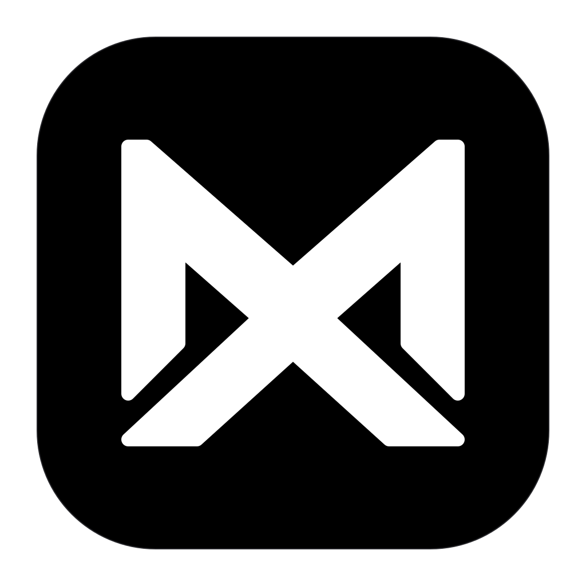
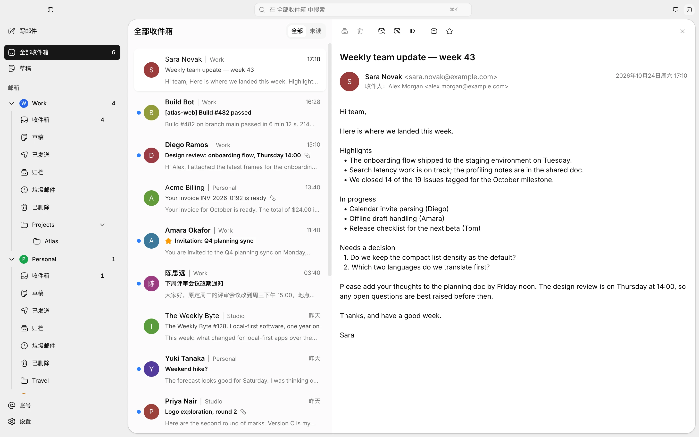

<div align="center">



# MailX

A fast, lightweight, local-first email client — built for every inbox, with AI at its core.

[](LICENSE)
[](https://github.com/GuqierMcl/MailX/releases)
[](https://github.com/GuqierMcl/MailX/releases)


English | [简体中文](README.zh-CN.md)

</div>

> [!NOTE]
> Download published builds from [Releases](https://github.com/GuqierMcl/MailX/releases), read release changes in the [CHANGELOG](CHANGELOG.md), and check [known limitations](#known-limitations) before installing.

<picture>
  <source media="(prefers-color-scheme: dark)" srcset="docs/assets/screenshots/mailx-dark.webp">
  
</picture>

## Features

- **Fast and lightweight** — A Rust core on the system WebView, with no bundled browser engine. MailX opens straight into your locally cached mail, on Windows, macOS and Linux.
- **One inbox for every account** — Read all your mailboxes in a single unified inbox. Search headers, previews, cached message bodies and attachment names locally. Read and starred states sync back to the server; archive locally or delete with a short undo window.
- **Safe reading** — Message bodies download when you open them and render in an isolated sandbox that cannot reach the app. Remote images wait until you allow them.
- **Composing in its own window** — A rich-text editor for new mail, replies and forwards, with attachments and pasted screenshots. Drafts are saved locally as you type.
- **Sending you can trust** — Every message goes through a send queue, with an optional undo delay and retries for eligible failures. A message the server may already have accepted is never sent twice on its own. Local sent copies appear in the Sent folder while waiting for a matching server copy.
- **Per-account network routing** — Each account can connect directly or through its own SOCKS5 or HTTP proxy. If the proxy fails, MailX stops rather than quietly connecting without it.
- **At home on your desktop** — IMAP IDLE for prompt inbox updates, new-mail notifications, optional background operation and launch at login, in-app updates, light and dark themes, English and Chinese.
- **Connect your AI tools** — An optional local MCP server lets compatible clients search and read mail, organize messages, manage drafts and attachments, and send mail. Copy the client configuration from Settings → MCP; MailX must be running.

## Supported Mailboxes

These providers have built-in presets: pick one, enter your address and the password or authorization code your provider issues for mail clients, and the server settings are filled in for you.

|  |  |  |  |  |
| :---: | :---: | :---: | :---: | :---: |
| QQ Mail | 163 Mail | 126 Mail | Yeah Mail | 139 Mail |

Any other mailbox that offers IMAP and SMTP with password sign-in can be added by entering its servers manually. OAuth sign-in for services such as Gmail and Outlook is planned; password and app-password compatibility depends on the provider and account settings. Compatibility with real providers has only been partly verified so far — if your mailbox misbehaves, please [open an issue](https://github.com/GuqierMcl/MailX/issues).

<sub>Provider names and logos are trademarks of their respective owners and are shown only to identify the service.</sub>

## Privacy & Data

- **Your mail is stored locally.** Headers, downloaded messages, drafts and attachments are kept in a local database and files. There is no MailX account, cloud relay or telemetry; the mail cache itself is not encrypted by MailX.
- **Passwords live in the system keychain** — macOS Keychain, Windows Credential Manager or the Secret Service on Linux — and are never shown back in the app.
- **Connections you control.** MailX connects to your mail servers (through the account's proxy if set) and checks GitHub for updates, which you can turn off. Enabling avatar lookups or allowing remote images also makes requests to the relevant image services. Avatar lookups are off by default, and remote images ask first.
- **Mail you send carries its own images.** Pictures inserted into the body travel inside the message; displaying them does not require downloading from an external image server.
- **MCP is off by default.** Enabling it grants connected local clients access to all accounts, draft management, local file attachments and direct sending without per-message confirmation. A client may forward mail content to its AI provider. Disable MCP in Settings to revoke access; MCP cannot delete mail.

## Roadmap

| Module | Status |
| --- | --- |
| Desktop app: receiving, reading, local search, multiple accounts | ✅ Available |
| Desktop app: composing and sending | ✅ Available |
| Desktop app: showing sent copies in the Sent folder | ✅ Implemented |
| Full-text search of local content | ✅ Implemented |
| OAuth sign-in (Gmail, Outlook) | 🗓️ Planned |
| Built-in AI assistant | 🗓️ Planned |
| Local MCP server for external AI clients | ✅ Implemented |
| Server: self-hosted web version | 🗓️ Planned |

What changed in each release is in the [CHANGELOG](CHANGELOG.md); the detailed roadmap is in [docs/roadmap/README.md](docs/roadmap/README.md) (written in Chinese).

## Known Limitations

- MailX currently supports password / authorization-code IMAP and SMTP accounts. OAuth, a built-in AI assistant, and the self-hosted web version are not available yet.
- Initial synchronization starts with a fixed 30-day window and fills up to the newest 1,000 messages per folder per round, retaining previously cached messages. Search covers local content; unopened message bodies may be missing from results. Attachments are searched by name, not by their contents.
- Archive is local to this computer. Moving messages to arbitrary server folders and synchronizing local drafts to the server are not implemented. Sent copies do not upload to the server.
- Builds are available for Windows, macOS and Linux, but feature and provider coverage differs. See the [validation record](docs/development/validation.md) for tested combinations and remaining gaps.

## Getting Started

### Download

Published builds are on the [Releases](https://github.com/GuqierMcl/MailX/releases) page:

| Platform | File |
| --- | --- |
| macOS (Apple silicon) | `MailX_<version>_macos-arm64.dmg` |
| macOS (Intel) | `MailX_<version>_macos-x64.dmg` |
| Windows | `MailX_<version>_windows-x64-setup.exe` |
| Linux | `.AppImage`, `.deb` or `.rpm` (`linux-x64`) |

The builds are not code-signed, so your system may block the first launch; the install notes in each release explain how to open them. The macOS, Windows and AppImage builds can update themselves from within the app. These builds have not been verified on every platform yet.

For account setup, sending, MCP and upgrade precautions, see the [getting started guide](docs/guides/README.md).

### Build from source

Prerequisites:

- [Bun](https://bun.sh/), using the version pinned in [package.json](package.json)
- Rust via rustup, which installs the toolchain pinned in [rust-toolchain.toml](rust-toolchain.toml)
- [Tauri platform dependencies](https://v2.tauri.app/start/prerequisites/)

```sh
bun install --frozen-lockfile
bun tauri dev       # run the desktop app in development mode
# Build unsigned local installers without the project's updater signing key
bun tauri build --config '{"bundle":{"createUpdaterArtifacts":false}}'
bun run check       # run the version, type, lint, test, build and Rust checks
```

See [docs/development/README.md](docs/development/README.md) for the full list of commands.

## Documentation

Design and development documentation is written in Chinese; the user guide, contributing, security and conduct documents are available in both English and Chinese.

- [Documentation index](docs/README.md)
- [Getting started](docs/guides/README.md) · [简体中文](docs/guides/zh-CN/README.md)
- [Architecture overview](docs/architecture/overview.md)
- [Product scope](docs/product/README.md)
- [AI design](docs/ai-runtime/README.md)
- [Development guide](docs/development/README.md)

## Contributing

Contributions are welcome. Please read [CONTRIBUTING.md](CONTRIBUTING.md) first; all participants are expected to follow the [Code of Conduct](CODE_OF_CONDUCT.md). To report a security issue, follow [SECURITY.md](SECURITY.md) and report it privately.

## License

MailX is licensed under the [Apache License 2.0](LICENSE).

Copyright 2026 GuqierMcl and MailX contributors.

---

MailX is not related to the Unix `mailx` command.
