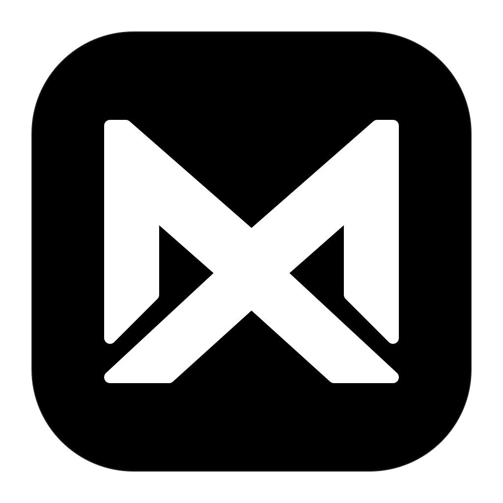
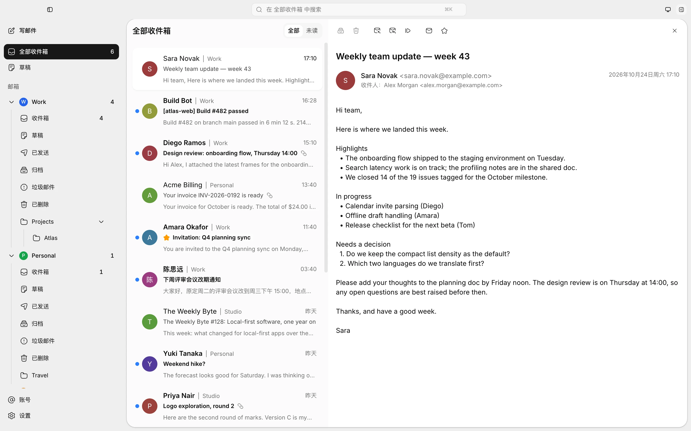

<div align="center">



# MailX

A fast, lightweight, local-first email client — built for every inbox, with AI at its core.

[](LICENSE)
[](https://github.com/GuqierMcl/MailX/releases)
[](https://github.com/GuqierMcl/MailX/releases)


English | [简体中文](README.zh-CN.md)

</div>

> [!NOTE]
> MailX is in early development. Things may change quickly — issues and pull requests are welcome.

<picture>
  <source media="(prefers-color-scheme: dark)" srcset="docs/assets/screenshots/mailx-dark.webp">
  
</picture>

## Features

- **Fast and lightweight** — A Rust core on the system WebView, with no bundled browser engine. MailX opens straight into your locally cached mail, on Windows, macOS and Linux.
- **One inbox for every account** — Read all your mailboxes in a single unified inbox. Search and paging run against your local copy, and read and starred states sync back to the server.
- **Safe reading** — Message bodies download when you open them and render in an isolated sandbox that cannot reach the app. Remote images wait until you allow them.
- **Composing in its own window** — A rich-text editor for new mail, replies and forwards, with attachments and pasted screenshots. Drafts are saved locally as you type.
- **Sending you can trust** — Every message goes through a send queue: undo right after sending, automatic retries, and a message the server may already have accepted is never sent twice on its own.
- **Per-account network routing** — Each account can connect directly or through its own SOCKS5 or HTTP proxy. If the proxy fails, MailX stops rather than quietly connecting without it.
- **At home on your desktop** — New-mail notifications, keeps running in the tray after you close the window, in-app updates, light and dark themes, English and Chinese.

## Supported Mailboxes

These providers have built-in presets: pick one, enter your address and the password or authorization code your provider issues for mail clients, and the server settings are filled in for you.

|  |  |  |  |  |
| :---: | :---: | :---: | :---: | :---: |
| QQ Mail | 163 Mail | 126 Mail | Yeah Mail | 139 Mail |

Any other mailbox that offers IMAP and SMTP with password sign-in can be added by entering its servers manually. Signing in with OAuth (as Gmail and Outlook require) is not supported yet. Compatibility with real providers has only been partly verified so far — if your mailbox misbehaves, please [open an issue](https://github.com/GuqierMcl/MailX/issues).

<sub>Provider names and logos are trademarks of their respective owners and are shown only to identify the service.</sub>

## Privacy & Data

- **Your mail stays on your machine.** Headers, downloaded messages and drafts are kept in a local database. There is no MailX account, cloud relay or telemetry.
- **Passwords live in the system keychain** — macOS Keychain, Windows Credential Manager or the Secret Service on Linux — and are never shown back in the app.
- **Only expected connections.** MailX talks to your mail servers (through the account's proxy if set) and checks GitHub for updates, which you can turn off. Sender avatar lookups are off until you enable them, and remote images in messages ask first.
- **Mail you send carries its own images.** Pictures in the body travel inside the message, so opening it never loads anything from outside.

## Roadmap

| Module | Status |
| --- | --- |
| Desktop app: receiving, reading, local search, multiple accounts | ✅ Available |
| Desktop app: composing and sending | ✅ Available |
| Desktop app: showing sent copies in the Sent folder | 🚧 In progress |
| Full-text search | 🗓️ Planned |
| OAuth sign-in (Gmail, Outlook) | 🗓️ Planned |
| AI assistant | 🗓️ Planned |
| MCP server (lets external AI tools access your mailbox safely, with your approval) | 🗓️ Planned |
| Server: self-hosted web version | 🗓️ Planned |

What changed in each release is in the [CHANGELOG](CHANGELOG.md); the detailed roadmap is in [docs/roadmap/README.md](docs/roadmap/README.md) (written in Chinese).

## Getting Started

### Download

Early builds are published on the [Releases](https://github.com/GuqierMcl/MailX/releases) page:

| Platform | File |
| --- | --- |
| macOS (Apple silicon) | `MailX_<version>_macos-arm64.dmg` |
| macOS (Intel) | `MailX_<version>_macos-x64.dmg` |
| Windows | `MailX_<version>_windows-x64-setup.exe` |
| Linux | `.AppImage`, `.deb` or `.rpm` (`linux-x64`) |

The builds are not code-signed, so your system may block the first launch; the install notes in each release explain how to open them. The macOS, Windows and AppImage builds can update themselves from within the app. These builds have not been verified on every platform yet.

### Build from source

Prerequisites:

- [Bun](https://bun.sh/) 1.3.12 (the version pinned in `package.json`)
- Rust 1.94.0 (pinned in `rust-toolchain.toml`; rustup installs it on first use)
- [Tauri platform dependencies](https://v2.tauri.app/start/prerequisites/)

```sh
bun install
bun tauri dev       # run the desktop app in development mode
bun tauri build     # build release installers for the current platform (unsigned)
bun run check       # run the version, type, lint, test, build and Rust checks
```

See [docs/development/README.md](docs/development/README.md) for the full list of commands.

## Documentation

Documentation is currently written in Chinese.

- [Documentation index](docs/README.md)
- [Architecture overview](docs/architecture/overview.md)
- [Product scope](docs/product/README.md)
- [AI design](docs/ai-runtime/README.md)
- [Development guide](docs/development/README.md)

## Contributing

Contributions are welcome. Please read [CONTRIBUTING.md](CONTRIBUTING.md) first. To report a security issue, follow [SECURITY.md](SECURITY.md) and report it privately.

## License

MailX is licensed under the [Apache License 2.0](LICENSE).

Copyright 2026 GuqierMcl and MailX contributors.

---

MailX is not related to the Unix `mailx` command.
