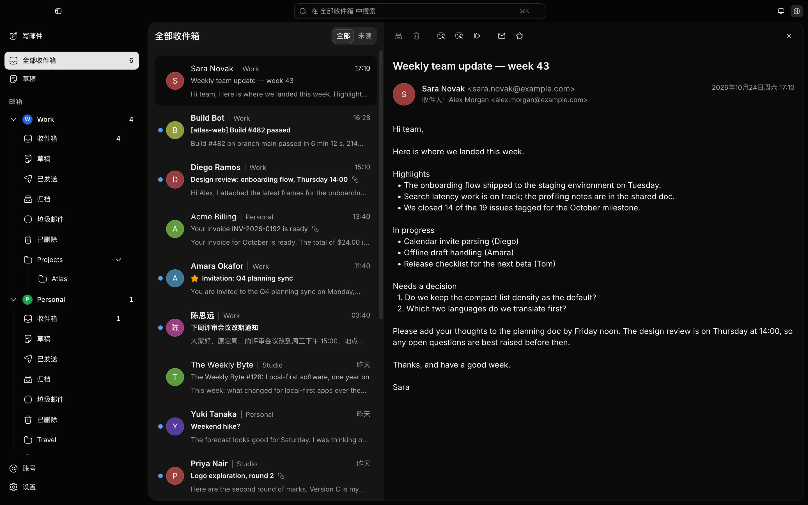

<div align="center">


# MailX

A fast, lightweight, local-first email client — built for every inbox, with AI at its core.

[](LICENSE)
[](https://github.com/GuqierMcl/MailX/releases)


English | [简体中文](README.zh-CN.md)

</div>

> [!NOTE]
> MailX is in early development. Things may change quickly — issues and pull requests are welcome.

<p align="center">
  
</p>
<p align="center">
  
</p>

## Features

- **Fast** — A Rust core reads from the local cache first, so MailX opens straight into your mail.
- **Lightweight** — Built on Tauri with the system WebView instead of bundling a browser engine.
- **Cross-platform** — Windows, macOS and Linux from a single codebase.
- **All in One** — Multiple accounts share one unified inbox. MailX is designed for standard IMAP/SMTP mailboxes, and each account can connect directly or through a SOCKS5 or HTTP CONNECT proxy, with no silent fallback to a direct connection.
- **Rich-text composing** — A lightweight Tiptap editor in its own compose window: headings, bold/italic/underline/strikethrough, links, lists, quotes, alignment, a fixed color palette and Markdown shortcuts. Mail goes out as plain text plus HTML, and the core sanitizes everything you write. Drafts are saved locally, sends can be undone, and a message that may already have been accepted is never resent on its own.
- **Local-first & private** — Mail is stored and searched on your machine, with no MailX cloud relay. Remote images are off by default, and message bodies render in an isolated sandbox.
- **AI-native** *(planned)* — A built-in assistant for reading, organizing and writing, using your own cloud model key or a local model, plus two-way MCP integration. AI never sends mail on its own.
- **Self-hostable** *(planned)* — A single-user web version you can deploy with Docker.

## Roadmap

| Module | Status |
| --- | --- |
| Desktop app: receiving, reading, search, multiple accounts | 🚧 In progress |
| Desktop app: composing and sending (rich-text editor, replies and forwards, reliable send queue) | 🚧 In progress |
| Compose attachments and inline images | 🗓️ Planned |
| Full-text search | 🗓️ Planned |
| OAuth sign-in (Gmail, Outlook) | 🗓️ Planned |
| AI assistant | 🗓️ Planned |
| MCP server (lets external AI tools access your mailbox safely, with your approval) | 🗓️ Planned |
| Server: self-hosted web version | 🗓️ Planned |

The detailed roadmap is in [docs/roadmap/README.md](docs/roadmap/README.md) (written in Chinese).

## Getting Started

### Build from source

Prebuilt packages are not available yet.

Prerequisites:

- [Bun](https://bun.sh/) 1.3.12 (the version pinned in `package.json`)
- Rust 1.94.0 (pinned in `rust-toolchain.toml`; rustup installs it on first use)
- [Tauri platform dependencies](https://v2.tauri.app/start/prerequisites/)

```sh
bun install
bun tauri dev       # run the desktop app in development mode
bun tauri build     # build a release binary (no installer is produced yet)
bun run check       # run the version, type, lint, test, build and Rust checks
```

See [docs/development/README.md](docs/development/README.md) for the full list of commands.

## Documentation

Documentation is currently written in Chinese.

- [Documentation index](docs/README.md)
- [Architecture overview](docs/architecture/overview.md)
- [Product scope](docs/product/README.md)
- [AI design](docs/ai-runtime/README.md)
- [Development guide](docs/development/README.md)

## Contributing

Contributions are welcome. Please read [CONTRIBUTING.md](CONTRIBUTING.md) first. To report a security issue, follow [SECURITY.md](SECURITY.md) and report it privately.

## License

MailX is licensed under the [Apache License 2.0](LICENSE).

Copyright 2026 GuqierMcl and MailX contributors.

---

MailX is not related to the Unix `mailx` command.
