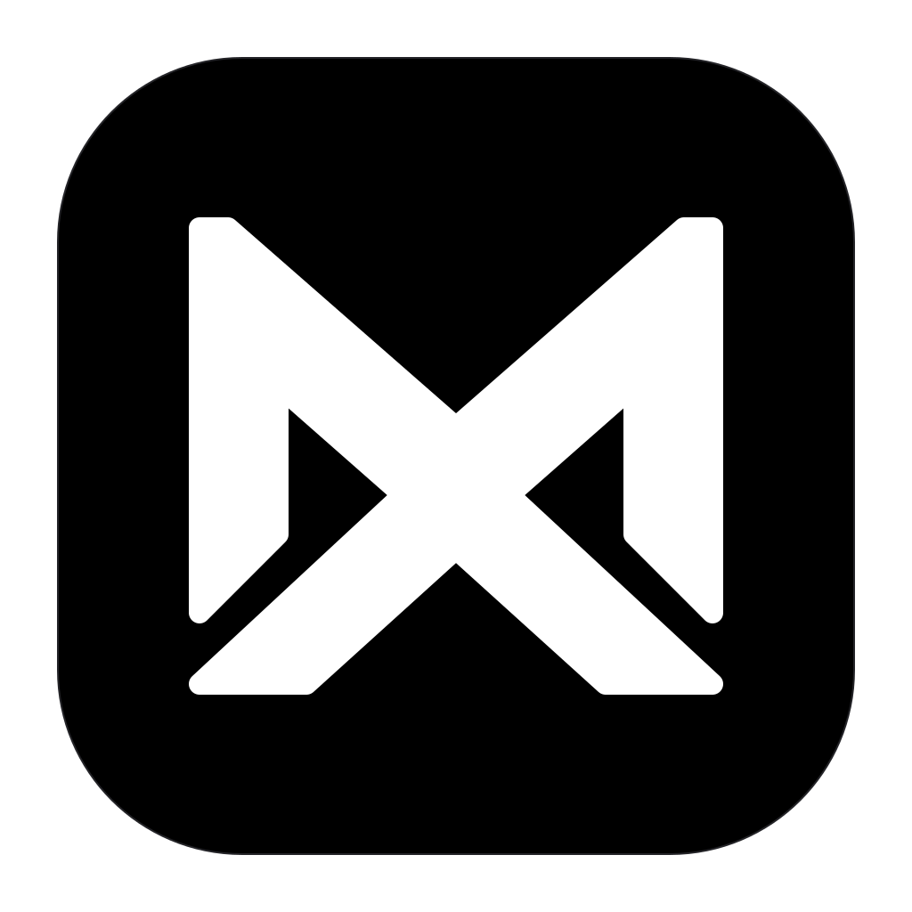
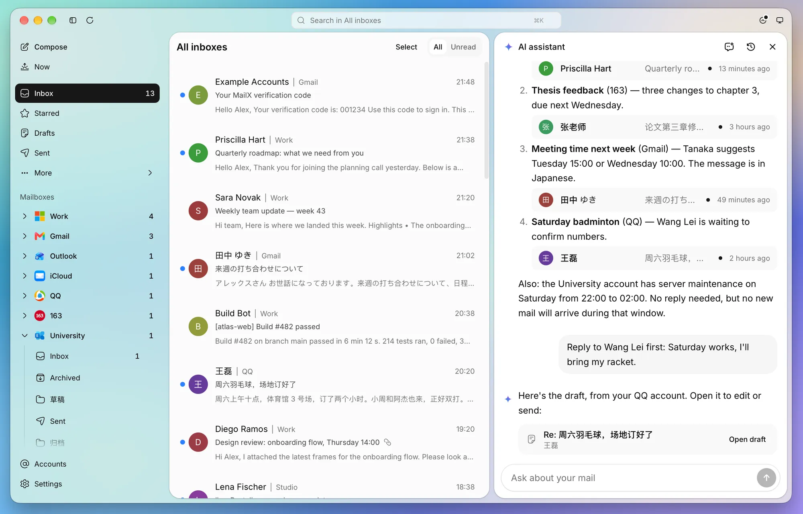
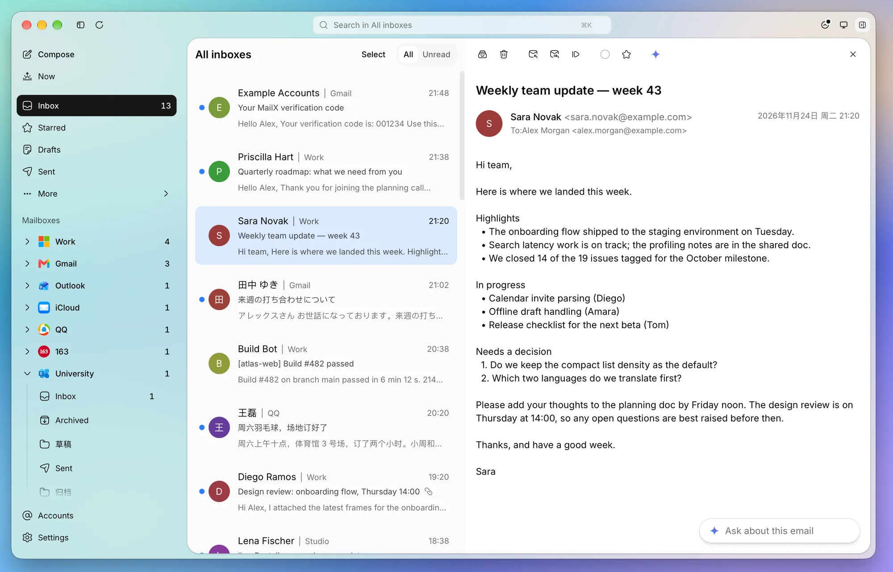
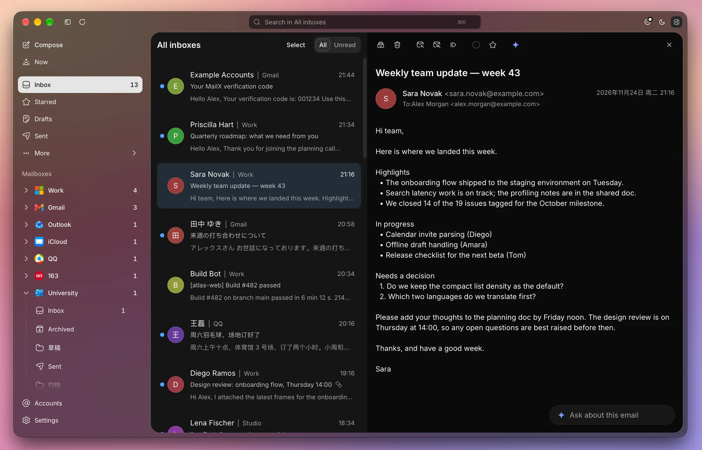
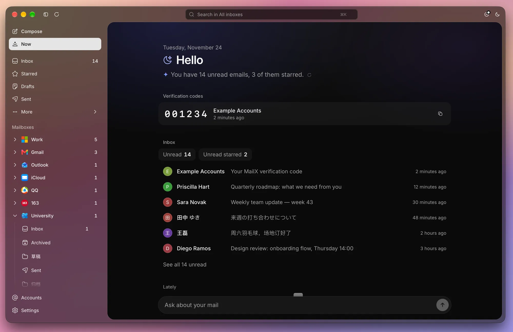
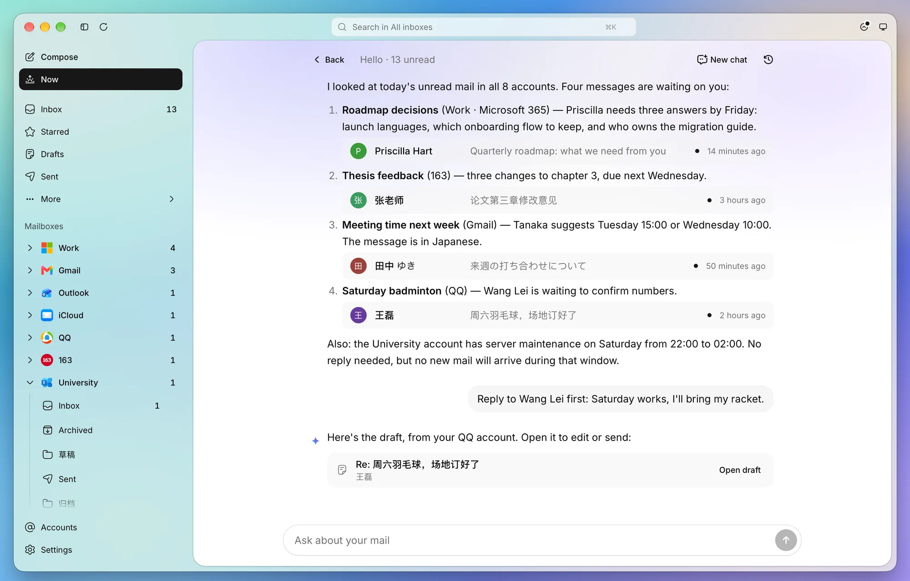
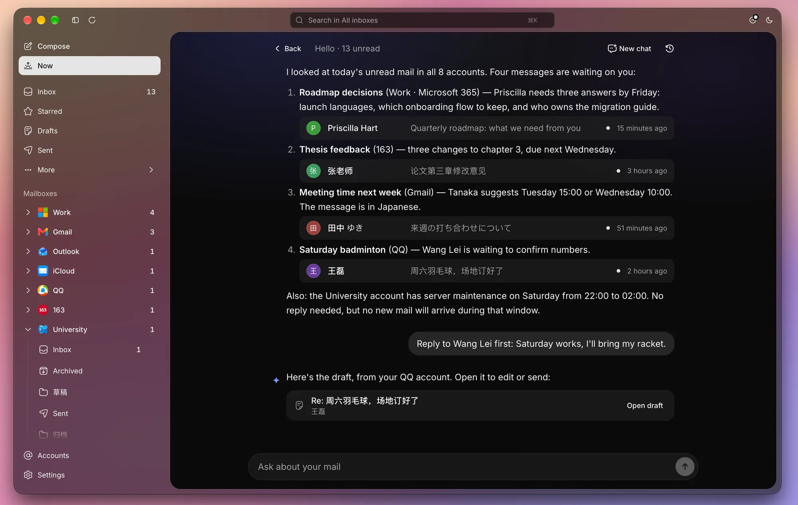
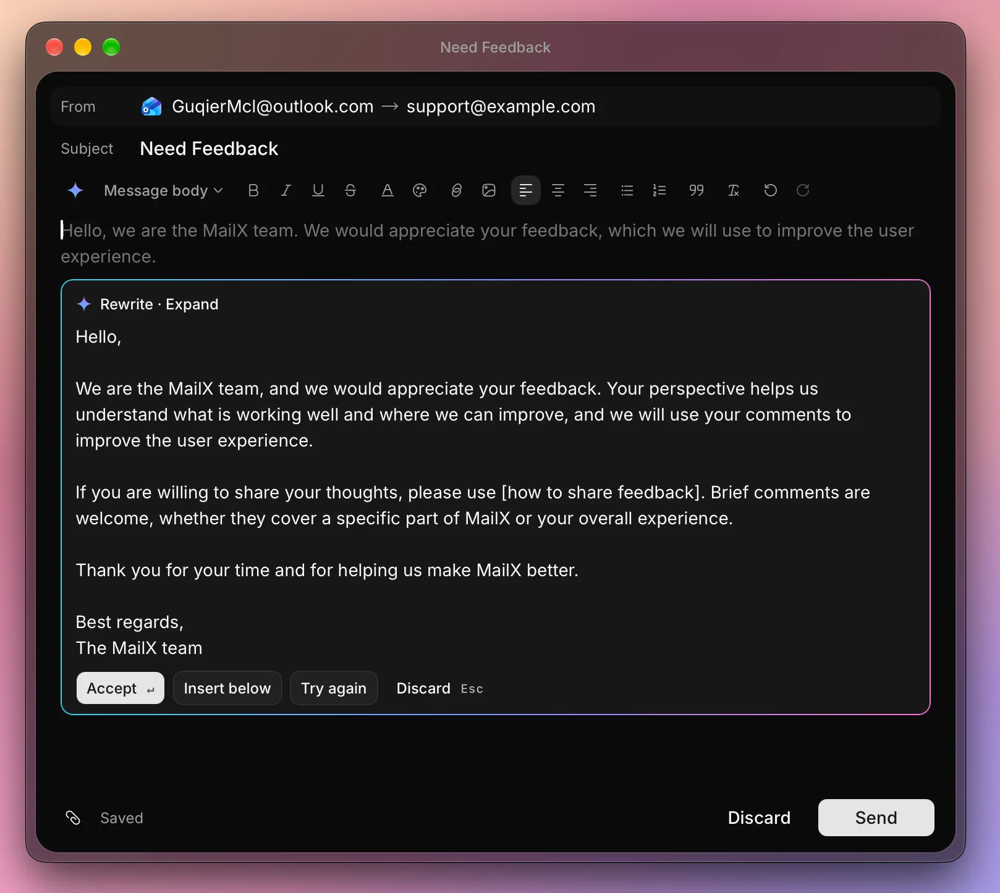

<div align="center">



# MailX

The local-first, AI-native email client—lightweight, fast, and built to unite all your inboxes effortlessly.

[](LICENSE)
[](https://github.com/GuqierMcl/MailX/releases)
[](https://github.com/GuqierMcl/MailX/releases)

English | [简体中文](README.zh-CN.md)

</div>




## Features

- **Every account, one inbox** — Add as many mailboxes as you like and read them together. Gmail, iCloud, Outlook, Microsoft 365, self-hosted Exchange, QQ Mail and 163 work out of the box; any other server that speaks IMAP and SMTP can be added by entering your settings.
- **Local first** — Mail, drafts and attachments live on your own computer, so the app opens straight into what it already has. No MailX account, no cloud relay, no telemetry, and search runs entirely on this machine.
- **AI native** — The built-in assistant works on your mail directly: it finds what needs a reply across every account, drafts answers and tidies the inbox. It shows what it did, cites the messages it used, and asks before it changes anything. If you'd rather use your own tools, connect them through the local MCP server.
- **Fast and light** — A Rust core on the system WebView, with no bundled browser engine. MailX opens into locally cached mail without waiting on the network.
- **Safe reading** — Message bodies render in an isolated sandbox that cannot reach the app, and remote images wait until you allow them.
- **Writing and sending you can trust** — A separate composer window with rich text, attachments and pasted screenshots, and drafts saved as you type. Every message goes through a send queue with an optional undo, retries for eligible failures, and no automatic resend of a message the server may already have accepted.
- **Translate in place** — Translate the message you are reading without disturbing its layout, with no setup or with a DeepL, Microsoft or Google key of your own. Nothing is sent until you agree.
- **At home on your desktop** — IMAP IDLE for prompt inbox updates, new-mail notifications and an unread badge on the app icon, plus optional background operation, launch at login, in-app updates, light and dark themes, and an English and Chinese interface.

## Screenshots

**Reading**

| Light | Dark |
| :---: | :---: |
|  |  |

**Now**

| Light | Dark |
| :---: | :---: |
|  |  |

**Assistant conversation**

| Light | Dark |
| :---: | :---: |
|  |  |

**Composing, with AI rewriting**

| Light | Dark |
| :---: | :---: |
|  |  |

## Supported Mailboxes

These services have been tested for compatibility and for sending and receiving. Pick one, enter your address and the password, authorization code or app-specific password your provider issues for mail clients, and the server settings are filled in for you; Outlook and Microsoft 365 sign in through your browser instead.

<p align="center">
  
  
  
  
  
  
  
  
  
  
  
  
  
</p>

Gmail · iCloud Mail · Outlook · Microsoft 365 · Exchange (self-hosted) · QQ Mail · 163 Mail · 126 Mail · Yeah Mail · 139 Mail · Sina Free Mail · Feishu Mail · Lark Mail

Mailboxes that are not on this list but support IMAP and SMTP can still be added by entering their server settings by hand. Setup details and requirements for each service are in the [account setup guide](docs/guides/README.md).

<sub>Provider names and logos are trademarks of their respective owners and are shown only to identify the service.</sub>

## Download

Published builds are on the [Releases](https://github.com/GuqierMcl/MailX/releases) page:

| Platform | File |
| --- | --- |
| macOS (Apple silicon) | `MailX_<version>_macos-arm64.dmg` |
| macOS (Intel) | `MailX_<version>_macos-x64.dmg` |
| Windows | `MailX_<version>_windows-x64-setup.exe` |
| Linux | `.AppImage`, `.deb` or `.rpm` (`linux-x64`) |

The macOS build is signed with a Developer ID and notarized, so it opens normally after download. The Windows and Linux builds are not code-signed yet, so your system may block the first launch; the install notes in each release explain how to open them. The macOS, Windows and AppImage builds can update themselves from within the app. These builds have not been verified on every platform yet.

For account setup, sending, MCP and upgrade precautions, see the [getting started guide](docs/guides/README.md).

### Build from source

Prerequisites:

- [Bun](https://bun.sh/), using the version pinned in [package.json](package.json)
- Rust via rustup, which installs the toolchain pinned in [rust-toolchain.toml](rust-toolchain.toml)
- [Tauri platform dependencies](https://v2.tauri.app/start/prerequisites/)

```sh
bun install --frozen-lockfile
bun tauri dev       # run the desktop app in development mode
bun run desktop:dev:isolated  # same, with its own data, passwords and app identity
# Build unsigned local installers without the project's updater signing key
bun tauri build --config '{"bundle":{"createUpdaterArtifacts":false}}'
bun run check       # run the version, type, lint, test, build and Rust checks
```

See [docs/development/README.md](docs/development/README.md) for the full list of commands.

## Privacy & Data

- **Your mail is stored locally.** Headers, downloaded messages, drafts and attachments are kept in a local database and files. There is no MailX account, cloud relay or telemetry; the mail cache itself is not encrypted by MailX.
- **Passwords live in the system keychain** — macOS Keychain, Windows Credential Manager or the Secret Service on Linux — and are never shown back in the app.
- **Connections you control.** Each account can connect directly or through its own SOCKS5 or HTTP proxy, and if the proxy fails MailX stops rather than quietly connecting without it. MailX connects to your mail servers and checks GitHub for updates, which you can turn off; enabling avatar lookups or allowing remote images also makes requests to the relevant image services. Avatar lookups are off by default, and remote images ask first.
- **Mail you send carries its own images.** Pictures inserted into the body travel inside the message; displaying them does not require downloading from an external image server.
- **Translation sends text only when you ask.** After you agree, translating a message sends its subject and text to the service you chose, and nothing else; a key of your own stays in the system keychain, and an optional proxy is used for translation only. Saved translations stay on this computer.
- **MCP is off by default.** Enabling it grants connected local clients access to all accounts, draft management, local file attachments, attachment export and direct sending without per-message confirmation. A client may forward mail content to its AI provider. Disable MCP in Settings to revoke access; MCP cannot delete mail.

## Known Limitations

- Archive is local to this computer. Moving messages to arbitrary server folders and synchronizing local drafts to the server are not implemented, and local sent copies do not upload.
- Initial synchronization starts with a fixed 30-day window and fills up to the newest 1,000 messages per folder per round, retaining previously cached messages. Search covers local content; unopened message bodies may be missing from results, and attachments are searched by name, not by their contents.
- Browser sign-in for Gmail and other providers, and the self-hosted web version, are still planned.

## Documentation

Design and development documentation is written in Chinese; the user guide, contributing, security and conduct documents are available in both English and Chinese.

- [Documentation index](docs/README.md)
- [Getting started](docs/guides/README.md) · [简体中文](docs/guides/zh-CN/README.md)
- [Architecture overview](docs/architecture/overview.md)
- [Product scope](docs/product/README.md)
- [AI design](docs/ai-runtime/README.md)
- [Development guide](docs/development/README.md)
- [Roadmap](docs/roadmap/README.md)

## Contributing

Contributions are welcome. Please read [CONTRIBUTING.md](CONTRIBUTING.md) first; all participants are expected to follow the [Code of Conduct](CODE_OF_CONDUCT.md). To report a security issue, follow [SECURITY.md](SECURITY.md) and report it privately.

## License

MailX is licensed under the [Apache License 2.0](LICENSE).

Copyright 2026 GuqierMcl and MailX contributors.

---

MailX is not related to the Unix `mailx` command.
