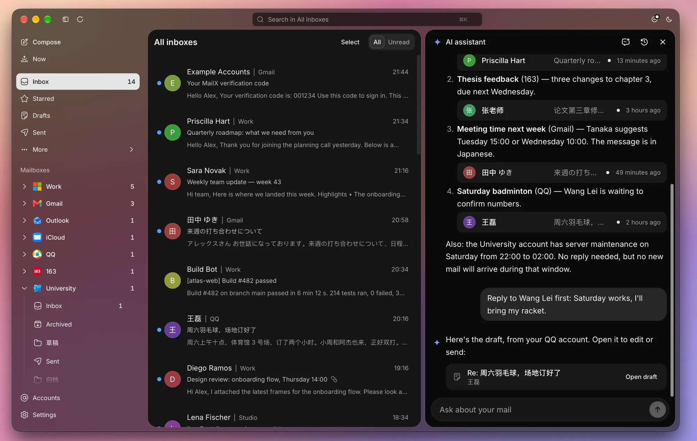
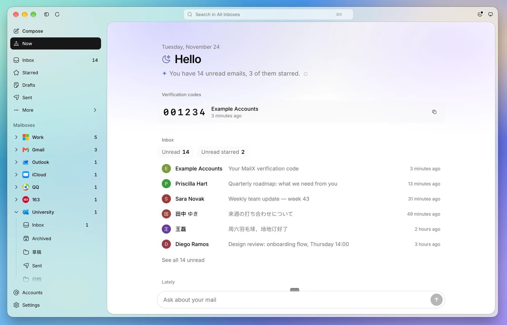
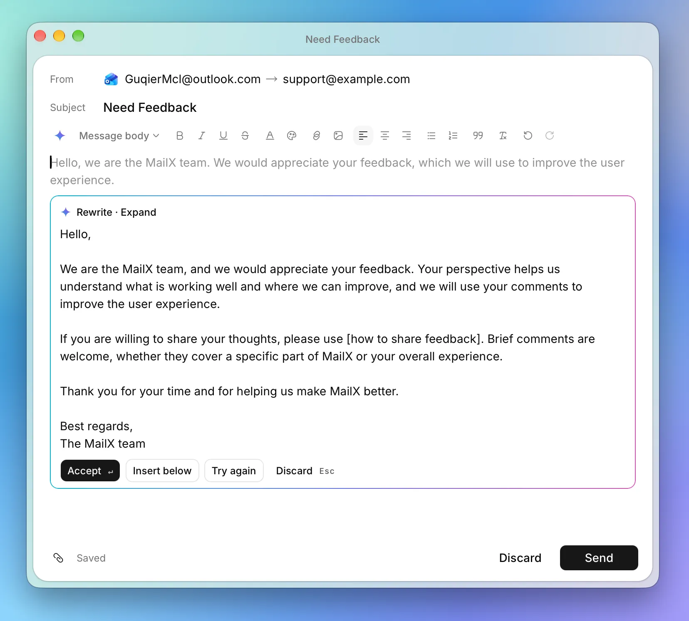

<div align="center">


# MailX

The local-first, AI-native email client—lightweight, fast, and built to unite all your inboxes effortlessly.

[](LICENSE)
[](https://github.com/GuqierMcl/MailX/releases)
[](https://github.com/GuqierMcl/MailX/releases)

English | [简体中文](README.zh-CN.md)

[Website](https://mailxapp.com/en/) · [Docs](https://mailxapp.com/en/docs/) · [Releases](https://github.com/GuqierMcl/MailX/releases)

</div>




## Features

### Unified Inbox & Reliable Sending

- **Every account, one inbox** — Add as many mailboxes as you like and read them together. Gmail, iCloud, Outlook, Microsoft 365, self-hosted Exchange, QQ Mail, and 163 work out of the box; any other IMAP/SMTP server can be added manually.
- **Fast and light** — Built on a Rust core and the system WebView, with no bundled browser engine. MailX opens straight into locally cached mail without waiting on the network.
- **Writing and sending you can trust** — A dedicated composer window supports rich text, attachments, pasted screenshots, and continuous draft saving. Sends go through a queue with optional undo, automatic retries for eligible failures, and protection against resending mail the server may already have accepted.
- **At home on your desktop** — IMAP IDLE for prompt inbox updates, new-mail notifications, an unread badge on the app icon, background operation, launch at login, in-app updates, light/dark themes, and an English/Chinese interface.

### Built-in AI & Translation

- **AI native** — The built-in assistant finds what needs a reply across all accounts, drafts responses, and helps tidy your inbox. It explains its actions, cites source messages, and asks before making changes—or you can connect your own tools via the local MCP server.
- **Translate in place** — Translate messages without disturbing their layout, either out of the box or with your own DeepL, Microsoft, or Google key. Nothing is sent until you agree.

### Local-First & Safe Reading

- **Local first** — Mail, drafts, and attachments live on your computer, with local full-text search and zero MailX accounts, cloud relays, or telemetry.
- **Safe reading** — Message bodies render in an isolated sandbox that cannot reach the app, and remote images stay blocked until you allow them.

## Screenshots

**Reading**

| Light | Dark |
| :---: | :---: |
|  |  |

**Now**

| Light | Dark |
| :---: | :---: |
|  |  |

**Assistant conversation**

| Light | Dark |
| :---: | :---: |
|  |  |

**Composing, with AI rewriting**

| Light | Dark |
| :---: | :---: |
|  |  |

## Supported Mailboxes

These services have been tested for compatibility and for sending and receiving, with server settings filled in automatically:

- **Browser sign-in (OAuth):** Outlook, Microsoft 365
- **Password / app-specific password / authorization code:** Gmail, iCloud Mail, Exchange (self-hosted), QQ Mail, 163 Mail, 126 Mail, Yeah Mail, 139 Mail, Sina Free Mail, Feishu Mail, Lark Mail

<p align="center">
  
  
  
  
  
  
  
  
  
  
  
  
  
</p>

Gmail · iCloud Mail · Outlook · Microsoft 365 · Exchange (self-hosted) · QQ Mail · 163 Mail · 126 Mail · Yeah Mail · 139 Mail · Sina Free Mail · Feishu Mail · Lark Mail

Mailboxes that are not on this list but support IMAP and SMTP can still be added by entering their server settings by hand. Setup details and requirements for each service are in the [account setup guide](docs/guides/README.md).

<sub>Provider names and logos are trademarks of their respective owners and are shown only to identify the service.</sub>

## Download

Published builds are on the [Releases](https://github.com/GuqierMcl/MailX/releases) page:

| Platform | File |
| --- | --- |
| macOS (Apple silicon) | `MailX_<version>_macos-arm64.dmg` |
| macOS (Intel) | `MailX_<version>_macos-x64.dmg` |
| Windows | `MailX_<version>_windows-x64-setup.exe` |
| Linux (x64) | `.AppImage`, `.deb` or `.rpm` (`linux-x64`) |
| Linux (ARM64) | `.AppImage`, `.deb` or `.rpm` (`linux-arm64`) |

Linux packages for both architectures are built on Ubuntu 24.04. On Ubuntu, use 24.04 or later.

The macOS build is signed with a Developer ID and notarized, so it opens normally after download. The Windows and Linux builds are not code-signed yet, so your system may block the first launch; the install notes in each release explain how to open them. The macOS, Windows and AppImage builds can update themselves from within the app. These builds have not been verified on every platform yet.

For account setup, sending, MCP and upgrade precautions, see the [getting started guide](docs/guides/README.md).

### Build from source

Prerequisites:

- [Bun](https://bun.sh/), using the version pinned in [package.json](package.json)
- Rust via rustup, which installs the toolchain pinned in [rust-toolchain.toml](rust-toolchain.toml)
- [Tauri platform dependencies](https://v2.tauri.app/start/prerequisites/)

```sh
bun install --frozen-lockfile
bun run desktop:dev           # run the desktop app in development mode
bun run desktop:dev:isolated  # same, with its own data, passwords and app identity
# Build unsigned local installers without the project's updater signing key
bun tauri build --config '{"bundle":{"createUpdaterArtifacts":false}}'
bun run check                 # run version, i18n, generated types, typecheck, lint, test, build and Rust checks
```

See [docs/development/README.md](docs/development/README.md) for the full list of commands.

## Privacy & Data

| Data | Where it lives or goes | Control |
| --- | --- | --- |
| Mail, drafts & attachments | Local database & files (unencrypted cache) | No MailX account, cloud relay, or telemetry |
| Passwords & API keys | System keychain (Keychain / Credential Manager / Secret Service) | Never displayed back in the app |
| Mail connections & updates | Your mail servers; GitHub (launch & hourly update checks) | Per-account SOCKS5/HTTP proxy (no direct fallback); auto-download can be disabled |
| Remote images & avatars | External image hosts | Remote images ask first; avatar lookups are off by default |
| Translation | Your chosen translation service (subject & body text only) | Sent only after you agree; saved translations stay local |
| AI assistant & summaries | Your configured model provider (or local Ollama) | Sent only after first-time consent; attachments & image contents are never sent |
| Local MCP server | Connected local MCP clients | Off by default; disabling revokes access; cannot delete mail |

- **Mail you send carries its own images.** Pictures inserted into the body travel inside the message; displaying them does not require downloading from an external image server.
- **AI details:** After consent, your prompt along with the text, subject, sender, recipients, date, and attachment names of involved mail or drafts are sent to the provider you configured (scoped to the mailboxes you allow). Opening AI settings also fetches a public model catalog from [models.dev](https://models.dev). Chats and summaries stay on this computer, and consent can be withdrawn in Settings.
- **MCP details:** Enabling MCP grants connected local clients access to all accounts, draft management, local file attachments, attachment export, and direct sending without per-message confirmation (a client may forward mail content to its AI provider).

See the [privacy guide](docs/guides/en/privacy.md) for the full breakdown.

## Known Limitations

- Archive is local to this computer. Moving messages to arbitrary server folders and synchronizing local drafts to the server are not implemented, and local sent copies do not upload.
- Initial synchronization starts with a fixed 30-day window and fills up to the newest 1,000 messages per folder per round, retaining previously cached messages. Search covers local content; unopened message bodies may be missing from results, and attachments are searched by name, not by their contents.
- Browser sign-in for Gmail and other providers, and the self-hosted web version, are still planned.

## Documentation

Design and development documentation is written in Chinese; the user guide, contributing, security, and conduct documents are available in both English and Chinese.

| Audience | Documents |
| --- | --- |
| **Users** | [Online docs](https://mailxapp.com/en/docs/) · [Getting started](docs/guides/README.md) ([简体中文](docs/guides/zh-CN/README.md)) · [Privacy](docs/guides/en/privacy.md) |
| **Contributors** | [Documentation index](docs/README.md) · [Architecture overview](docs/architecture/overview.md) · [Product scope](docs/product/README.md) · [AI design](docs/ai-runtime/README.md) · [Development guide](docs/development/README.md) · [Roadmap](docs/roadmap/README.md) |

## Contributing

Contributions are welcome. Please read [CONTRIBUTING.md](CONTRIBUTING.md) first; all participants are expected to follow the [Code of Conduct](CODE_OF_CONDUCT.md). To report a security issue, follow [SECURITY.md](SECURITY.md) and report it privately.

## License

MailX is licensed under the [Apache License 2.0](LICENSE).

Copyright 2026 GuqierMcl and MailX contributors.
