<div align="center">

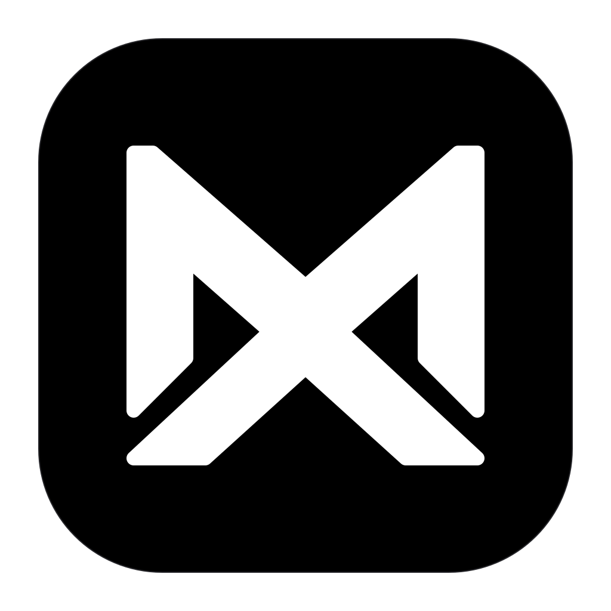

# MailX

Yerel öncelikli, yapay zeka destekli e-posta istemcisi — hafif, hızlı ve tüm gelen kutularınızı zahmetsizce birleştirmek için tasarlandı.

[](LICENSE)
[](https://github.com/GuqierMcl/MailX/releases)
[](https://github.com/GuqierMcl/MailX/releases)

[English](README.md) | [简体中文](README.zh-CN.md) | Türkçe

[Web Sitesi](https://mailxapp.com/en/) · [Belgeler](https://mailxapp.com/en/docs/) · [Sürümler](https://github.com/GuqierMcl/MailX/releases)

</div>

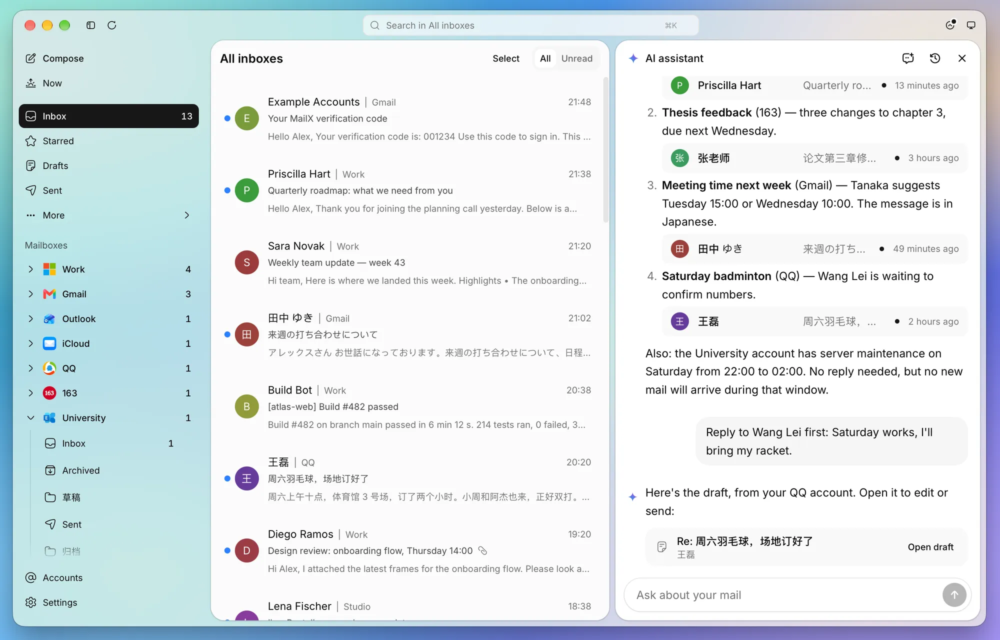

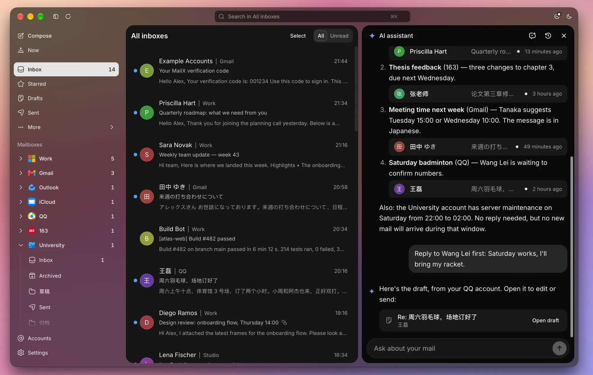

## Özellikler

### Birleşik Gelen Kutusu ve Güvenilir Gönderim

- **Her hesap, tek gelen kutusu** — İstediğiniz kadar posta kutusu ekleyin ve hepsini bir arada okuyun. Gmail, iCloud, Outlook, Microsoft 365, kendi barındırdığınız Exchange, QQ Mail ve 163 kutudan çıktığı gibi çalışır; diğer tüm IMAP/SMTP sunucuları elle eklenebilir.
- **Hızlı ve hafif** — Paketlenmiş tarayıcı motoru olmadan Rust çekirdeği ve sistem WebView'ı üzerine kurulmuştur. MailX ağa bağlı kalmadan doğrudan yerel olarak önbelleğe alınmış postalara açılır.
- **Güvenebileceğiniz yazma ve gönderme** — Özel bir oluşturucu penceresi zengin metin, ekler, yapıştırılan ekran görüntüleri ve kesintisiz taslak kaydetmeyi destekler. Gönderimler isteğe bağlı geri alma, uygun hatalar için otomatik yeniden deneme ve sunucunun zaten kabul etmiş olabileceği postaların tekrar gönderilmesine karşı koruma içeren bir kuyruktan geçer.
- **Masaüstünüze tam uyum** — Anlık gelen kutusu güncellemeleri için IMAP IDLE, yeni posta bildirimleri, uygulama simgesinde okunmamış rozeti, arka planda çalışma, oturum açılışında başlatma, uygulama içi güncellemeler, açık/koyu temalar ve İngilizce/Çince arayüz.

### Yerleşik Yapay Zeka ve Çeviri

- **Yapay zeka odaklı** — Yerleşik asistan tüm hesaplarda yanıtlanması gerekenleri bulur, yanıt taslakları oluşturur ve gelen kutunuzu düzenlemenize yardımcı olur. Eylemlerini açıklar, kaynak iletileri alıntılar ve değişiklik yapmadan önce sorar — ya da yerel MCP sunucusu üzerinden kendi araçlarınızı bağlayabilirsiniz.
- **Yerinde çeviri** — İletileri düzenlerini bozmadan, doğrudan veya kendi DeepL, Microsoft ya da Google anahtarınızla çevirin. Siz onaylayana kadar hiçbir şey gönderilmez.

### Yerel Öncelikli ve Güvenli Okuma

- **Yerel öncelikli** — Postalar, taslaklar ve ekler bilgisayarınızda yaşar; yerel tam metin araması sunar ve sıfır MailX hesabı, bulut aktarımı veya telemetri içerir.
- **Güvenli okuma** — İleti gövdeleri uygulamaya erişemeyen yalıtılmış bir korumalı alanda (sandbox) işlenir ve uzak görseller siz izin verene kadar engelli kalır.

## Ekran Görüntüleri

**Okuma**

| Açık | Koyu |
| :---: | :---: |
| 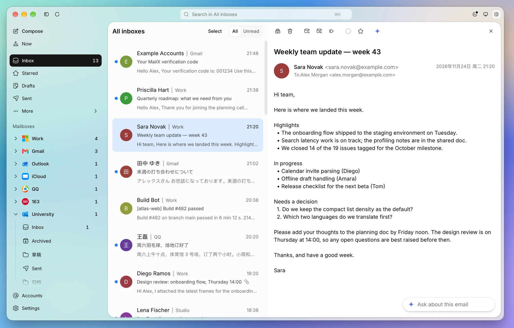 | 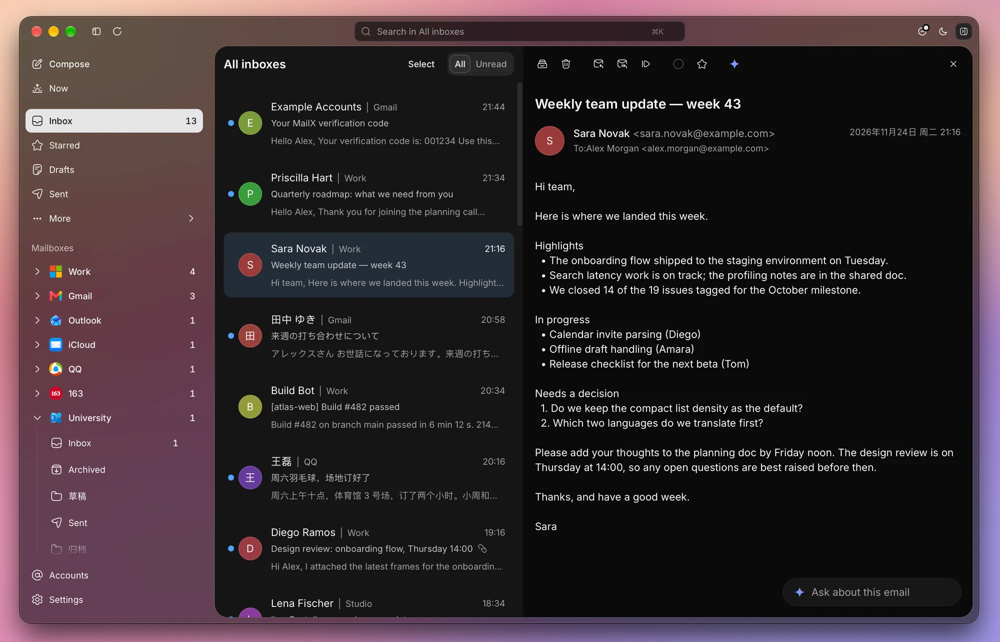 |

**Şimdi (Now)**

| Açık | Koyu |
| :---: | :---: |
| 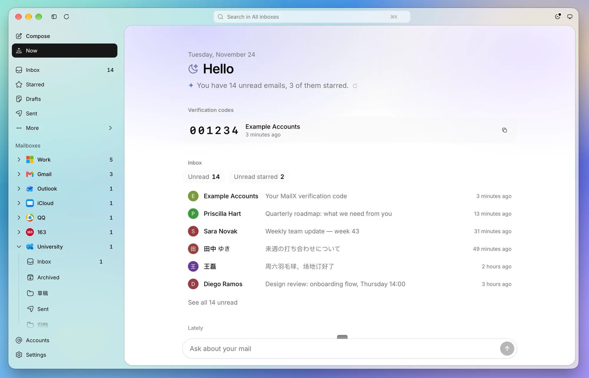 | 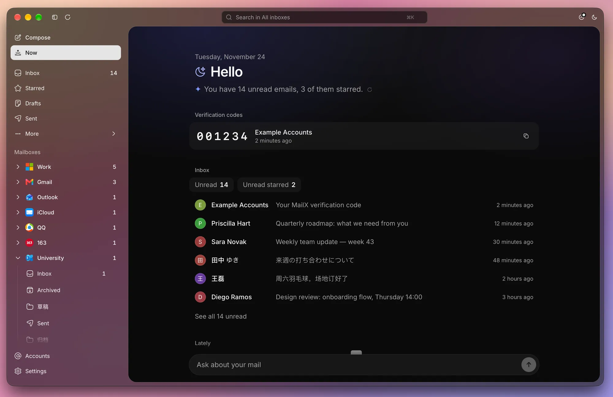 |

**Asistan sohbeti**

| Açık | Koyu |
| :---: | :---: |
| 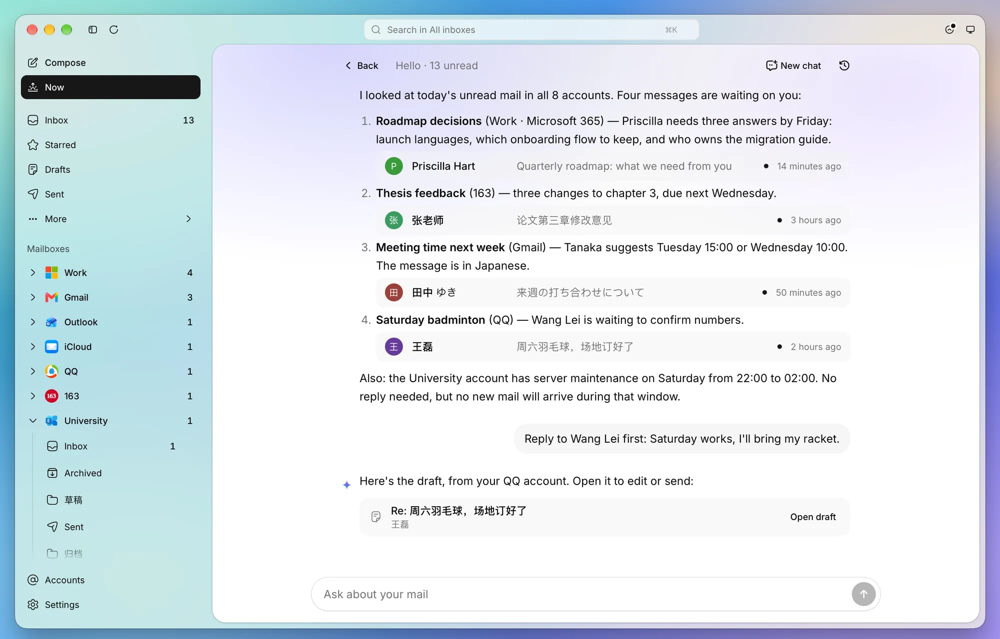 | 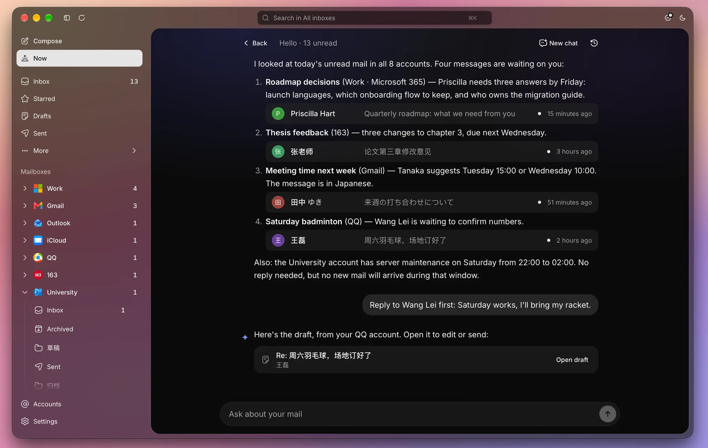 |

**Yapay zeka ile yeniden yazma destekli oluşturma**

| Açık | Koyu |
| :---: | :---: |
| 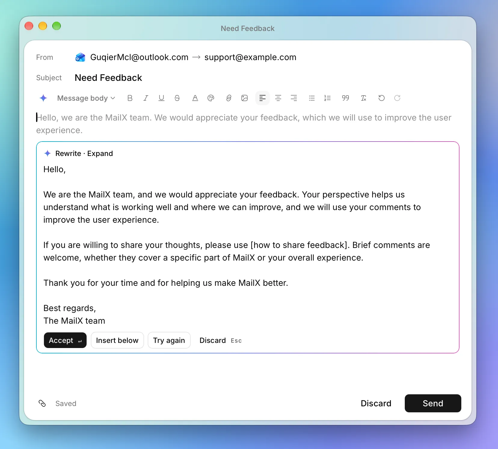 | 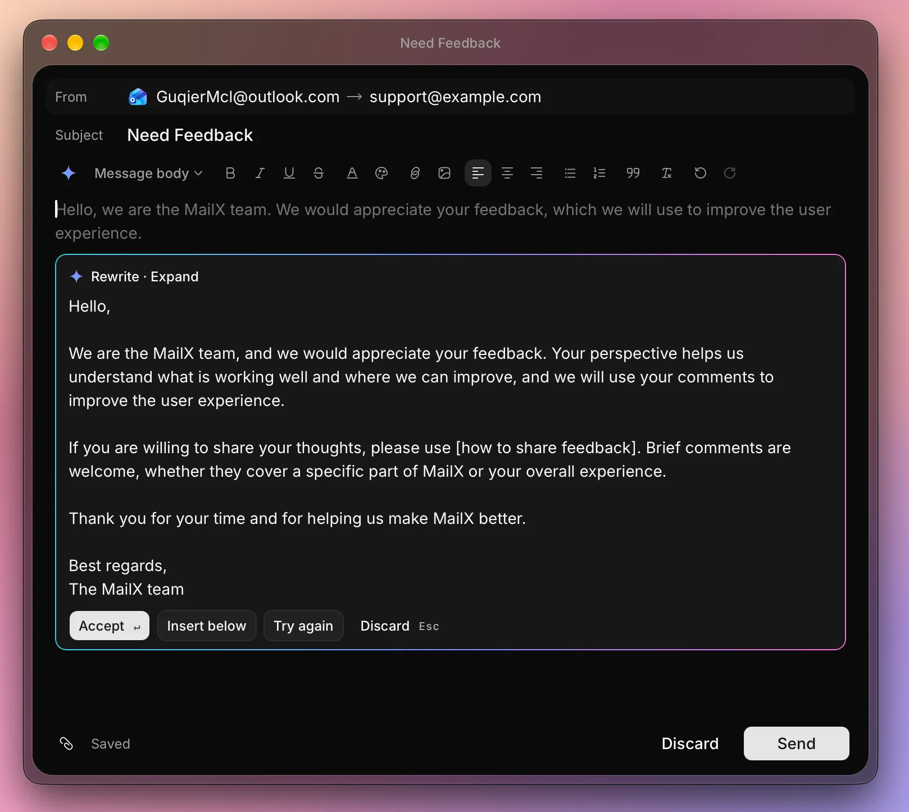 |

## Desteklenen Posta Kutuları

Bu servisler uyumluluk ile gönderme ve alma açısından test edilmiştir ve sunucu ayarları otomatik olarak doldurulur:

- **Tarayıcı ile oturum açma (OAuth):** Outlook, Microsoft 365
- **Parola / uygulamaya özel parola / yetkilendirme kodu:** Gmail, iCloud Mail, Exchange (kendi barındırılan), QQ Mail, 163 Mail, 126 Mail, Yeah Mail, 139 Mail, Sina Free Mail, Feishu Mail, Lark Mail

<p align="center">
  
  
  
  
  
  
  
  
  
  
  
  
  
</p>

Gmail · iCloud Mail · Outlook · Microsoft 365 · Exchange (kendi barındırılan) · QQ Mail · 163 Mail · 126 Mail · Yeah Mail · 139 Mail · Sina Free Mail · Feishu Mail · Lark Mail

Bu listede olmayan ancak IMAP ve SMTP destekleyen posta kutuları, sunucu ayarları elle girilerek yine de eklenebilir. Her servis için kurulum ayrıntıları ve gereksinimler [hesap kurulum kılavuzu](docs/guides/README.md) içindedir.

<sub>Sağlayıcı adları ve logoları ilgili sahiplerinin ticari markalarıdır ve yalnızca servisi tanımlamak amacıyla gösterilir.</sub>

## İndir

Yayınlanan derlemeler [Releases](https://github.com/GuqierMcl/MailX/releases) sayfasındadır:

| Platform | Dosya |
| --- | --- |
| macOS (Apple silicon) | `MailX_<version>_macos-arm64.dmg` |
| macOS (Intel) | `MailX_<version>_macos-x64.dmg` |
| Windows | `MailX_<version>_windows-x64-setup.exe` |
| Linux (x64) | `.AppImage`, `.deb` veya `.rpm` (`linux-x64`) |
| Linux (ARM64) | `.AppImage`, `.deb` veya `.rpm` (`linux-arm64`) |

Kullanılabilir Linux paketleri için her sürümü kontrol edin. ARM64 içeren sürümler için her iki mimaride de Ubuntu 24.04 veya üzeri kullanın.

macOS derlemesi bir Developer ID ile imzalanmıştır ve noter onaylıdır, bu nedenle indirildikten sonra normal şekilde açılır. Windows ve Linux derlemeleri henüz kod imzalı değildir, bu yüzden sisteminiz ilk başlatmayı engelleyebilir; her sürümdeki kurulum notları bunların nasıl açılacağını açıklar. macOS, Windows ve AppImage derlemeleri uygulama içinden kendilerini güncelleyebilir. Bu derlemeler henüz her platformda doğrulanmamıştır.

Hesap kurulumu, gönderme, MCP ve yükseltme önlemleri için [başlangıç kılavuzu](docs/guides/README.md) belgesine bakın.

### Kaynaktan derleme

Önkoşullar:

- [package.json](package.json) içinde sabitlenen sürümü kullanan [Bun](https://bun.sh/)
- [rust-toolchain.toml](rust-toolchain.toml) içinde sabitlenen araç zincirini kuran rustup aracılığıyla Rust
- [Tauri platform bağımlılıkları](https://v2.tauri.app/start/prerequisites/)

```sh
bun install --frozen-lockfile
bun run desktop:dev           # run the desktop app in development mode
bun run desktop:dev:isolated  # same, with its own data, passwords and app identity
# Build unsigned local installers without the project's updater signing key
bun tauri build --config '{"bundle":{"createUpdaterArtifacts":false}}'
bun run check                 # run version, i18n, generated types, typecheck, lint, test, build and Rust checks
```

Komutların tam listesi için [docs/development/README.md](docs/development/README.md) dosyasına bakın.

## Gizlilik ve Veriler

| Veri | Nerede yaşar veya nereye gider | Kontrol |
| --- | --- | --- |
| Postalar, taslaklar ve ekler | Yerel veritabanı ve dosyalar (şifrelenmemiş önbellek) | MailX hesabı, bulut aktarımı veya telemetri yok |
| Parolalar ve API anahtarları | Sistem anahtarlığı (Keychain / Credential Manager / Secret Service) | Uygulamada bir daha asla geri gösterilmez |
| Posta bağlantıları ve güncellemeler | Posta sunucularınız; GitHub (başlatma ve saatlik güncelleme kontrolleri) | Hesap başına SOCKS5/HTTP vekil sunucusu (doğrudan geri dönüş yok); otomatik indirme devre dışı bırakılabilir |
| Uzak görseller ve avatarlar | Harici görsel barındırıcıları | Uzak görseller önce sorar; avatar aramaları varsayılan olarak kapalıdır |
| Çeviri | Seçtiğiniz çeviri servisi (yalnızca konu ve gövde metni) | Yalnızca siz onayladıktan sonra gönderilir; kaydedilen çeviriler yerelde kalır |
| Yapay zeka asistanı ve özetler | Yapılandırdığınız model sağlayıcısı (veya yerel Ollama) | Yalnızca ilk onaydan sonra gönderilir; ekler ve görsel içerikleri asla gönderilmez |
| Yerel MCP sunucusu | Bağlı yerel MCP istemcileri | Varsayılan olarak kapalı; devre dışı bırakmak erişimi iptal eder; postaları silemez |

- **Gönderdiğiniz posta kendi görsellerini taşır.** Gövdeye eklenen resimler iletinin içinde taşınır; görüntülenmesi harici bir görsel sunucusundan indirme gerektirmez.
- **Yapay zeka ayrıntıları:** Onaydan sonra isteminizle birlikte ilgili posta veya taslakların metni, konusu, göndereni, alıcıları, tarihi ve ek adları yapılandırdığınız sağlayıcıya gönderilir (izin verdiğiniz posta kutularıyla sınırlı olarak). Yapay zeka ayarlarını açmak ayrıca [models.dev](https://models.dev) üzerinden herkese açık bir model kataloğu çeker. Sohbetler ve özetler bu bilgisayarda kalır ve onay Ayarlar'dan geri çekilebilir.
- **MCP ayrıntıları:** MCP'yi etkinleştirmek, bağlı yerel istemcilere tüm hesaplara, taslak yönetimine, yerel dosya eklerine, ek dışa aktarmaya ve ileti başına onay olmadan doğrudan göndermeye erişim izni verir (bir istemci posta içeriğini kendi yapay zeka sağlayıcısına iletebilir).

Tam döküm için [gizlilik kılavuzu](docs/guides/en/privacy.md) belgesine bakın.

## Bilinen Kısıtlamalar

- Arşiv bu bilgisayara yereldir. İletileri rastgele sunucu klasörlerine taşıma ve yerel taslakları sunucuyla eşitleme uygulanmamıştır; yerel gönderilen kopyalar yüklenmez.
- İlk eşitleme sabit 30 günlük bir pencereyle başlar ve tur başına klasör başına en yeni 1.000 iletiye kadar doldurarak önceden önbelleğe alınmış iletileri korur. Arama yerel içeriği kapsar; açılmamış ileti gövdeleri sonuçlarda eksik olabilir ve ekler içeriklerine göre değil adlarına göre aranır.
- Gmail ve diğer sağlayıcılar için tarayıcıda oturum açma ve kendi barındırılan web sürümü hâlâ planlanmaktadır.

## Belgeler

Tasarım ve geliştirme belgeleri Çince yazılmıştır; kullanıcı kılavuzu, katkı, güvenlik ve davranış kuralları belgeleri hem İngilizce hem Çince olarak mevcuttur.

| Hedef Kitle | Belgeler |
| --- | --- |
| **Kullanıcılar** | [Çevrimiçi belgeler](https://mailxapp.com/en/docs/) · [Başlangıç kılavuzu](docs/guides/README.md) ([简体中文](docs/guides/zh-CN/README.md)) · [Gizlilik](docs/guides/en/privacy.md) |
| **Katkıda Bulunanlar** | [Belge dizini](docs/README.md) · [Mimari genel bakış](docs/architecture/overview.md) · [Ürün kapsamı](docs/product/README.md) · [Yapay zeka tasarımı](docs/ai-runtime/README.md) · [Geliştirme kılavuzu](docs/development/README.md) · [Yol haritası](docs/roadmap/README.md) |

## Katkıda Bulunma

Katkılarınızı bekliyoruz. Lütfen önce [CONTRIBUTING.md](CONTRIBUTING.md) dosyasını okuyun; tüm katılımcıların [Davranış Kuralları](CODE_OF_CONDUCT.md)'na uyması beklenir. Bir güvenlik sorunu bildirmek için [SECURITY.md](SECURITY.md) dosyasını izleyin ve gizli olarak bildirin.

## Lisans

MailX, [Apache License 2.0](LICENSE) altında lisanslanmıştır.

Telif Hakkı 2026 GuqierMcl ve MailX katkıda bulunanları.
