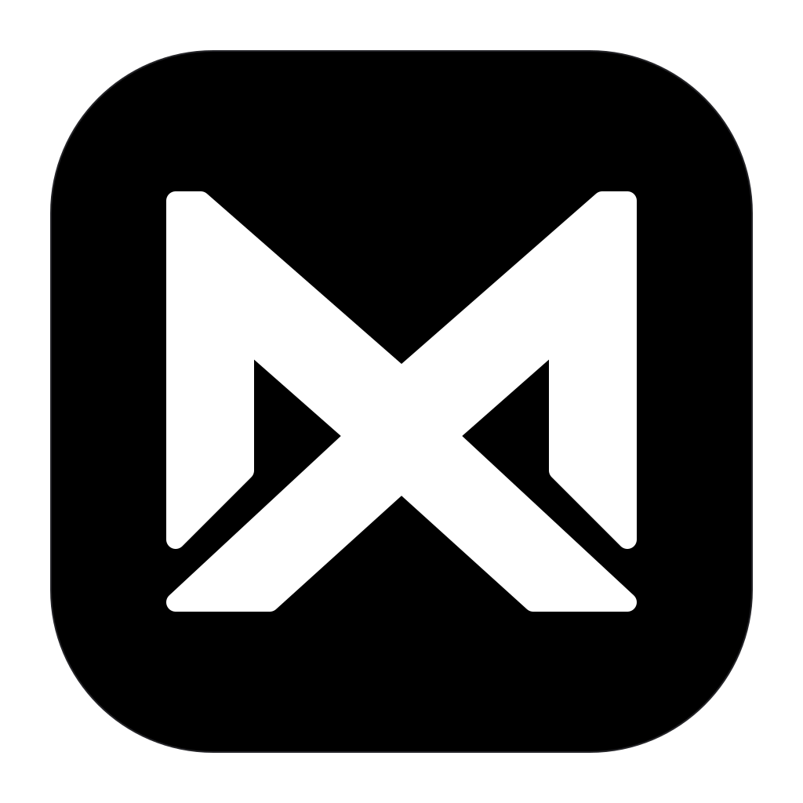
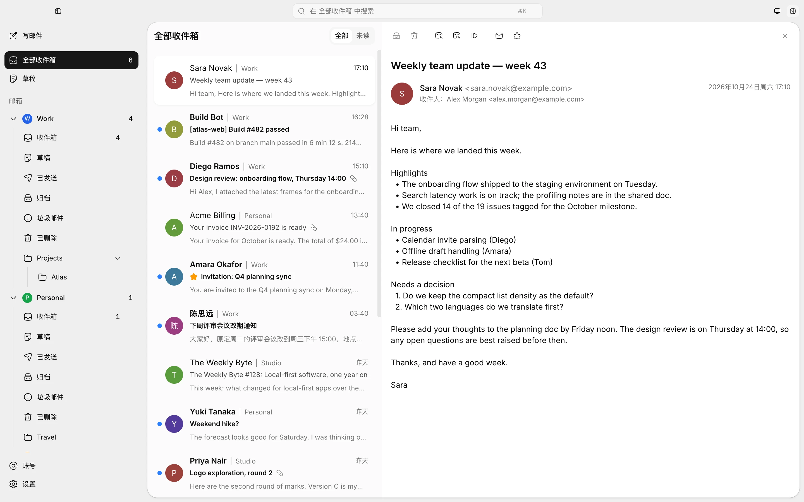
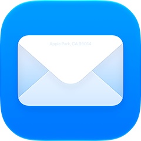

<div align="center">



# MailX

快速、轻量的本地优先邮件客户端 —— 面向每一个收件箱，以 AI 为核心。

[](LICENSE)
[](https://github.com/GuqierMcl/MailX/releases)
[](https://github.com/GuqierMcl/MailX/releases)


[English](README.md) | 简体中文

</div>

<picture>
  <source media="(prefers-color-scheme: dark)" srcset="docs/assets/screenshots/mailx-dark.webp">
  
</picture>

## 功能

- **快速轻量** —— Rust 核心运行在系统 WebView 上，不捆绑浏览器内核。在 Windows、macOS 和 Linux 上打开即进入本地缓存的邮件。
- **所有账号，一个收件箱** —— 多个邮箱汇总到一个统一收件箱。在本机搜索邮件头、预览、已缓存正文和附件名；已读与星标写回服务器，并支持本机归档和带短暂撤销窗口的删除。
- **安全阅读** —— 正文在打开时才下载，并在无法触及应用的隔离沙箱中渲染；远程图片要等你允许才加载。
- **翻译你正在读的邮件** —— 无需设置（默认 Microsoft 翻译，借用浏览器内置翻译的通道，非官方，可能失效），或用你自己的 DeepL、Microsoft Translator 或 Google Cloud Translation 密钥，原位翻译已打开的邮件并保留版式。你同意并点击翻译之前不会发送任何内容；附件和密码永远不会发送。
- **独立的写信窗口** —— 富文本撰写新邮件、回复和转发，可添加附件、粘贴截图；草稿边写边保存在本地。
- **可靠的发送** —— 每封邮件都经过发送队列，可设置撤销等待时间，符合条件的失败会自动重试；服务器可能已接受的邮件不会自动重发。在与服务器副本对上之前，已发送文件夹显示本机副本。
- **按账号路由网络** —— 每个账号可以直连，也可以走自己的 SOCKS5 或 HTTP 代理；代理失败时直接停止，不会悄悄改为直连。
- **桌面原生体验** —— IMAP IDLE 让收件箱及时更新，配合新邮件通知、可选的后台运行与开机自启动、应用内更新、浅色与深色主题、中英文界面。
- **连接你的 AI 工具** —— 可选的本地 MCP 服务器让兼容客户端搜索、阅读和整理邮件，管理草稿与附件，并直接发信。在“设置 → MCP”复制客户端配置即可连接，使用时需保持 MailX 运行。

## 支持的邮箱

以下服务商内置预设。多数服务商只需选择后填写邮箱地址和服务商为客户端提供的密码、授权码或应用专用密码，服务器设置会自动填好；Outlook 和 Microsoft 365 则改为在浏览器中登录。

|  |  |  |  |  |  |  |  |  |
| :---: | :---: | :---: | :---: | :---: | :---: | :---: | :---: | :---: |
| Gmail | iCloud 邮箱 | Outlook | Microsoft 365 / Exchange | QQ 邮箱 | 163 邮箱 | 126 邮箱 | Yeah 邮箱 | 139 邮箱 |

Gmail 接受 `@gmail.com` 和 `@googlemail.com` 地址，使用 Google 应用专用密码，需要先开启两步验证。生成方法和不可用的情况见[添加账号指南](docs/guides/zh-CN/README.md#gmail)。

iCloud 邮箱接受 `@icloud.com`、`@me.com` 和 `@mac.com` 地址，使用 Apple 应用专用密码。账号前提和用户名设置见[添加账号指南](docs/guides/zh-CN/README.md#icloud-邮箱)。

Outlook（个人 Outlook.com、Hotmail、Live 邮箱）和 Microsoft 365 / Exchange（工作或学校邮箱）通过浏览器中的微软登录页登录，不需要在 MailX 中输入密码。Outlook.com 需要先在 Outlook 设置中开启 IMAP；工作或学校账号可能需要管理员批准 MailX，或为邮箱允许 IMAP 和 SMTP。公司自己搭建的 Exchange 服务器不在这个入口范围内，如果它提供 IMAP 和 SMTP，可以手动添加。详见[添加账号指南](docs/guides/zh-CN/README.md#microsoftoutlook--microsoft-365)。

其他支持 IMAP / SMTP 密码登录的邮箱，可以手动填写服务器添加。Gmail 的浏览器登录（无需应用专用密码）在规划中；密码或应用专用密码能否使用取决于服务商与账号配置。与真实服务商的兼容性目前只做了部分验证，遇到问题欢迎[提交 issue](https://github.com/GuqierMcl/MailX/issues)。

<sub>服务商名称与 Logo 为其各自所有者的商标，仅用于标识服务商。</sub>

## 隐私与数据

- **邮件保存在本地。** 邮件头、已下载的邮件、草稿和附件保存在本地数据库与文件中。没有 MailX 账号、云端中转，也不收集遥测数据；MailX 本身不加密邮件缓存。
- **密码存放在系统钥匙串** —— macOS 钥匙串、Windows 凭据管理器或 Linux 的 Secret Service —— 应用不会再把它显示出来。
- **连接由你控制。** MailX 连接你的邮件服务器（设置了代理就经该账号的代理），并向 GitHub 检查更新（可以关闭）。启用发件人头像查询或允许远程图片后，也会向相应的图片服务发起请求；头像查询默认关闭，远程图片默认先询问。
- **发出的邮件自带图片。** 插入正文的图片随邮件一起发出，显示这些图片无需从外部图片服务器下载。
- **翻译只在你要求时发送文字。** 同意之后，翻译邮件只会把它的主题和文字发送给你选择的服务（免设置服务即微软或谷歌），不发送其他内容；你自己的密钥保存在系统钥匙串中，可选的代理只用于翻译。已保存的译文留在这台电脑上。
- **MCP 默认关闭。** 开启后，连接的本机客户端可访问所有账号、管理草稿、使用本机文件附件并直接发信，无需逐封确认。客户端可能把邮件内容转给其 AI 服务商。在设置中关闭 MCP 即可撤销访问；MCP 不能删除邮件。

## 路线图

| 模块 | 状态 |
| --- | --- |
| 桌面端：收信、阅读、本地搜索、多账号 | ✅ 可用 |
| 桌面端：撰写与发送 | ✅ 可用 |
| 桌面端：在已发送文件夹中显示发出的邮件 | ✅ 已实现 |
| 本地内容全文搜索 | ✅ 已实现 |
| 浏览器登录：Outlook、Microsoft 365 / Exchange | ✅ 已实现 |
| 浏览器登录：Gmail | 🗓️ 规划中 |
| 内置 AI 助手 | 🗓️ 规划中 |
| 翻译邮件，免设置或使用你自己的密钥 | ✅ 已实现（仅自动测试） |
| 供外部 AI 客户端使用的本地 MCP 服务 | ✅ 已实现 |
| 服务器：自托管 Web 版本 | 🗓️ 规划中 |

各版本的变化见 [CHANGELOG](CHANGELOG.md)，更详细的路线图见 [docs/roadmap/README.md](docs/roadmap/README.md)。

## 已知限制

- 当前支持使用密码、授权码或应用专用密码的 IMAP 和 SMTP 账号，以及 Outlook 和 Microsoft 365 的浏览器登录；Gmail 等其他服务商的浏览器登录、内置 AI 助手和自托管 Web 版本尚未提供。
- 首次同步从固定的最近 30 天窗口开始，每轮补齐各文件夹窗口中最新的一千封邮件头，已缓存的邮件会保留。搜索只覆盖本机内容，未打开过的正文可能不在结果中；附件按名称搜索，不搜索文件内容。
- 归档只在本机生效；移动到任意服务器文件夹和把本地草稿同步到服务器尚未实现。已发送的本机副本不会上传到服务器。
- 提供 Windows、macOS 和 Linux 构建，但各功能与服务商的覆盖范围不同。已验证的组合和剩余缺口见[验证记录](docs/development/validation.md)。

## 快速开始

### 下载

已发布构建位于 [Releases](https://github.com/GuqierMcl/MailX/releases) 页面：

| 平台 | 文件 |
| --- | --- |
| macOS（Apple 芯片） | `MailX_<版本>_macos-arm64.dmg` |
| macOS（Intel） | `MailX_<版本>_macos-x64.dmg` |
| Windows | `MailX_<版本>_windows-x64-setup.exe` |
| Linux | `.AppImage`、`.deb` 或 `.rpm`（`linux-x64`） |

安装包尚未做代码签名，系统可能拦截首次启动，各版本发布说明里的安装说明介绍了打开方法。macOS、Windows 和 AppImage 版本可以在应用内自动更新。这些构建尚未在每个平台上逐一验证。

添加账号、发信、连接 MCP 与升级注意事项见[使用入门](docs/guides/zh-CN/README.md)。

### 从源码构建

环境要求：

- [Bun](https://bun.sh/)，版本以 [package.json](package.json) 中的固定配置为准
- 通过 rustup 管理 Rust，首次使用时按 [rust-toolchain.toml](rust-toolchain.toml) 自动安装指定工具链
- [Tauri 平台依赖](https://v2.tauri.app/start/prerequisites/)

```sh
bun install --frozen-lockfile
bun tauri dev       # 以开发模式运行桌面应用
# 无项目更新签名私钥时，构建当前平台未签名的本地安装包
bun tauri build --config '{"bundle":{"createUpdaterArtifacts":false}}'
bun run check       # 运行版本、类型、Lint、测试、构建与 Rust 检查
```

完整命令列表见 [docs/development/README.md](docs/development/README.md)。

## 文档

架构、开发与契约等设计文档以中文撰写；使用入门、参与贡献、安全政策与行为准则提供中英两版。

- [文档入口](docs/README.md)
- [使用入门](docs/guides/zh-CN/README.md)（[English](docs/guides/README.md)）
- [架构总览](docs/architecture/overview.md)
- [产品范围](docs/product/README.md)
- [AI 设计](docs/ai-runtime/README.md)
- [开发指南](docs/development/README.md)

## 参与贡献

欢迎参与贡献。请先阅读 [CONTRIBUTING.md](CONTRIBUTING.md)（[简体中文](CONTRIBUTING.zh-CN.md)），并遵守[行为准则](CODE_OF_CONDUCT.md)（[简体中文](CODE_OF_CONDUCT.zh-CN.md)）。报告安全问题时请按 [SECURITY.md](SECURITY.md) 私下提交。

## 许可证

MailX 采用 [Apache License 2.0](LICENSE) 许可。

Copyright 2026 GuqierMcl and MailX contributors.

---

MailX 与 Unix 的 `mailx` 命令无关。
