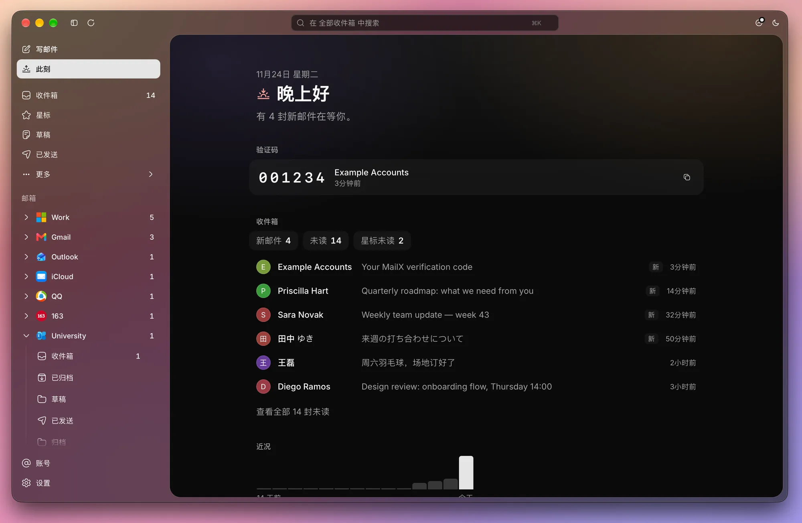
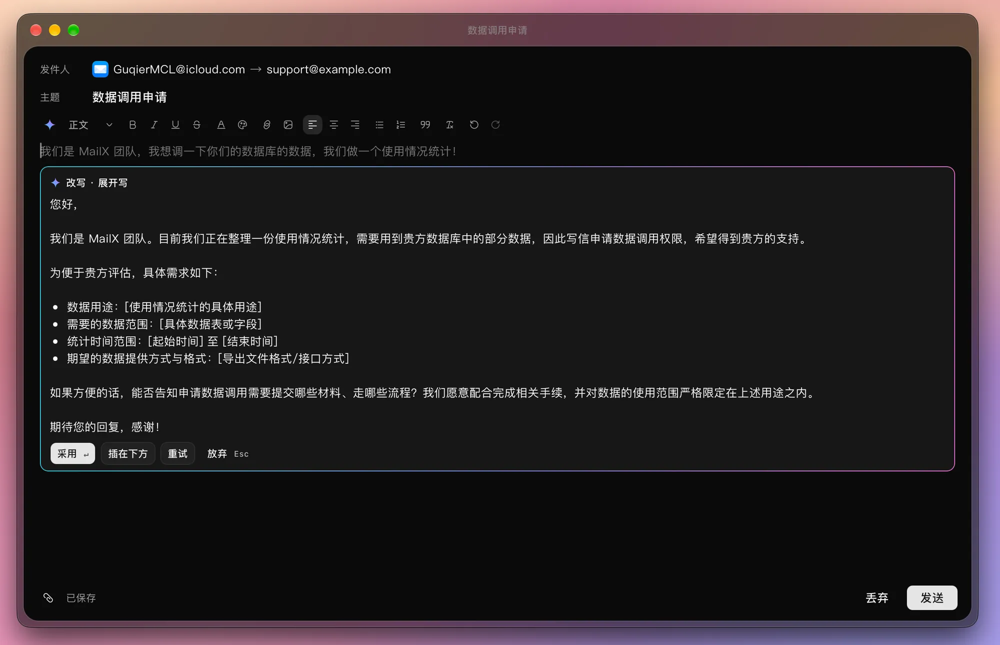
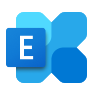

<div align="center">


# MailX

本地优先的 AI 原生邮件客户端——极速轻量，优雅聚合你的所有邮箱。

[](LICENSE)
[](https://github.com/GuqierMcl/MailX/releases)
[](https://github.com/GuqierMcl/MailX/releases)

[English](README.md) | 简体中文

[官网](https://mailxapp.com/zh-CN/) · [文档](https://mailxapp.com/zh-CN/docs/) · [发布版本](https://github.com/GuqierMcl/MailX/releases)

</div>


## 特性

### 统一收件箱与可靠收发

- **所有邮箱，一个收件箱** —— 多个账号汇入同一收件箱。Gmail、iCloud、Outlook、Microsoft 365、自建 Exchange、QQ、163 等服务商开箱可加，其余支持 IMAP/SMTP 的邮箱手动填写服务器即可接入。
- **极速轻量** —— Rust 核心运行在系统 WebView 上，不捆绑浏览器内核；打开应用直接进入本地缓存，无需等待网络请求。
- **写信与发送都可靠** —— 独立写信窗口支持富文本、附件、粘贴截图与边写边存草稿；每封邮件经过发送队列，支持发送撤销、符合条件的失败自动重试，且不会自动重发服务器可能已收到的邮件。
- **桌面原生体验** —— 支持 IMAP IDLE 即时收信、系统通知与图标未读角标、后台运行、开机自启动、应用内更新、浅色/深色主题与中英文界面。

### 内置 AI 与原位翻译

- **AI 原生** —— 内置助手跨账号找出需要回复的邮件、起草回复并协助整理；它会说明操作、引用具体邮件并在修改前征求同意，也可通过本地 MCP 接入你自己的 AI 工具。
- **原位翻译** —— 翻译正在阅读的邮件并保留原版式，可开箱使用或填入你自己的 DeepL、Microsoft、Google 密钥；同意之前不会发送任何内容。

### 本地优先与安全阅读

- **本地优先** —— 邮件、草稿与附件均保存在本地，支持本地全文搜索；没有 MailX 账号、云端中转或遥测收集。
- **安全阅读** —— 正文在隔离沙箱中渲染，无法访问应用本身；远程图片默认不加载，等你允许。

## 截图

**读邮件**

| 浅色 | 深色 |
| :---: | :---: |
|  |  |

**此刻**

| 浅色 | 深色 |
| :---: | :---: |
|  |  |

**AI 会话**

| 浅色 | 深色 |
| :---: | :---: |
|  |  |

**写信与 AI 改写**

| 浅色 | 深色 |
| :---: | :---: |
|  |  |

## 支持的邮箱

以下邮箱服务已通过兼容性与收发测试，服务器配置会自动填好：

- **浏览器登录（OAuth）：** Outlook、Microsoft 365
- **密码 / 授权码 / 应用专用密码：** Gmail、iCloud 邮箱、Exchange（自建服务器）、QQ 邮箱、163 邮箱、126 邮箱、Yeah 邮箱、139 邮箱、新浪免费邮箱、飞书邮箱、Lark 邮箱

<p align="center">
  
  
  
  
  
  
  
  
  
  
  
  
  
</p>

Gmail · iCloud 邮箱 · Outlook · Microsoft 365 · Exchange（自建服务器） · QQ 邮箱 · 163 邮箱 · 126 邮箱 · Yeah 邮箱 · 139 邮箱 · 新浪免费邮箱 · 飞书邮箱 · Lark 邮箱

不在此列、但支持 IMAP/SMTP 的邮箱，手动填写服务器同样可以添加。各服务的配置方式与前提见[添加账号指南](docs/guides/zh-CN/README.md)。

<sub>服务商名称与 Logo 为其各自所有者的商标，仅用于标识服务商。</sub>

## 下载

已发布构建位于 [Releases](https://github.com/GuqierMcl/MailX/releases) 页面：

| 平台 | 文件 |
| --- | --- |
| macOS（Apple 芯片） | `MailX_<版本>_macos-arm64.dmg` |
| macOS（Intel） | `MailX_<版本>_macos-x64.dmg` |
| Windows | `MailX_<版本>_windows-x64-setup.exe` |
| Linux（x64） | `.AppImage`、`.deb` 或 `.rpm`（`linux-x64`） |
| Linux（ARM64） | `.AppImage`、`.deb` 或 `.rpm`（`linux-arm64`） |

Linux 两种架构的安装包均基于 Ubuntu 24.04 构建。Ubuntu 用户请使用 24.04 或更新版本。

macOS 安装包已使用 Developer ID 签名并公证，下载后可以直接打开。Windows 与 Linux 安装包尚未做代码签名，系统可能拦截首次启动，各版本发布说明里的安装说明介绍了打开方法。macOS、Windows 和 AppImage 版本可以在应用内自动更新。这些构建尚未在每个平台上逐一验证。

添加账号、发信、连接 MCP 与升级注意事项见[使用入门](docs/guides/zh-CN/README.md)。

### 从源码构建

环境要求：

- [Bun](https://bun.sh/)，版本以 [package.json](package.json) 中的固定配置为准
- 通过 rustup 管理 Rust，首次使用时按 [rust-toolchain.toml](rust-toolchain.toml) 自动安装指定工具链
- [Tauri 平台依赖](https://v2.tauri.app/start/prerequisites/)

```sh
bun install --frozen-lockfile
bun run desktop:dev           # 以开发模式运行桌面应用
bun run desktop:dev:isolated  # 同上，但使用独立的数据、密码与应用标识
# 无项目更新签名私钥时，构建当前平台未签名的本地安装包
bun tauri build --config '{"bundle":{"createUpdaterArtifacts":false}}'
bun run check                 # 运行版本、i18n、类型生成、类型、Lint、测试、构建与 Rust 检查
```

完整命令列表见 [docs/development/README.md](docs/development/README.md)。

## 隐私与数据

| 数据类别 | 存储或发送去向 | 控制方式 |
| --- | --- | --- |
| 邮件、草稿与附件 | 本地数据库与文件（缓存本身未加密） | 无 MailX 账号、云端中转或遥测收集 |
| 密码与 API 密钥 | 系统钥匙串（Keychain / 凭据管理器 / Secret Service） | 应用内不会再次明文显示 |
| 邮箱连接与更新检查 | 你的邮件服务器；GitHub（启动时与每小时检查更新） | 支持单账号 SOCKS5/HTTP 代理（失败直接停止不回退直连）；可关闭自动下载 |
| 远程图片与发件人头像 | 对应图片服务 | 远程图片默认先询问；头像查询默认关闭 |
| 邮件翻译 | 你选择的翻译服务（仅主题与正文文本） | 仅在你同意后发送；已保存译文留在本机 |
| AI 助手与摘要 | 你自行配置的模型服务商（或本地 Ollama） | 首次发送前征求同意；不发送附件内容和图片 |
| 本地 MCP 服务 | 已连接的本地 MCP 客户端 | 默认关闭，关闭即撤销权限；无法删除邮件 |

- **发出的邮件自带图片。** 插入正文的图片随邮件一起发出，显示这些图片无需从外部图片服务器下载。
- **AI 说明：** 同意后，你的输入以及相关邮件或草稿的正文、主题、发件人、收件人、日期和附件名称会发送至你配置的服务商（助手仅可读取你允许的邮箱）。打开 AI 设置时还会从 [models.dev](https://models.dev) 获取公开的模型目录；对话与摘要均保存在本机，可随时在设置中撤回同意。
- **MCP 说明：** 开启后，已连接的本地客户端可访问所有账号、管理草稿、使用本机文件附件、导出邮件附件并直接发信，无需逐封确认（客户端可能将邮件内容转给其 AI 服务商）。

完整说明见[隐私说明](docs/guides/zh-CN/privacy.md)。

## 已知限制

- 归档只在本机生效；移动到任意服务器文件夹、把本地草稿同步到服务器尚未实现，已发送的本机副本也不会上传。
- 首次同步从最近 30 天开始，每轮补齐各文件夹最新的一千封邮件头，已缓存的邮件会保留。搜索只覆盖本机内容，未打开过的正文可能不在结果中；附件按名称搜索，不搜索文件内容。
- Gmail 等其他服务商的浏览器登录，以及自托管的 Web 版本，仍在规划中。

## 文档

架构、开发与契约等设计文档以中文撰写；使用入门、参与贡献、安全政策与行为准则提供中英两版。

| 面向人群 | 文档入口 |
| --- | --- |
| **用户** | [在线文档](https://mailxapp.com/zh-CN/docs/) · [使用入门](docs/guides/zh-CN/README.md)（[English](docs/guides/README.md)） · [隐私说明](docs/guides/zh-CN/privacy.md) |
| **开发者** | [文档入口](docs/README.md) · [架构总览](docs/architecture/overview.md) · [产品范围](docs/product/README.md) · [AI 设计](docs/ai-runtime/README.md) · [开发指南](docs/development/README.md) · [路线图](docs/roadmap/README.md) |

## 参与贡献

欢迎参与贡献。请先阅读 [CONTRIBUTING.md](CONTRIBUTING.md)（[简体中文](CONTRIBUTING.zh-CN.md)），并遵守[行为准则](CODE_OF_CONDUCT.md)（[简体中文](CODE_OF_CONDUCT.zh-CN.md)）。报告安全问题时请按 [SECURITY.md](SECURITY.md) 私下提交。

## 许可证

MailX 采用 [Apache License 2.0](LICENSE) 许可。

Copyright 2026 GuqierMcl and MailX contributors.
