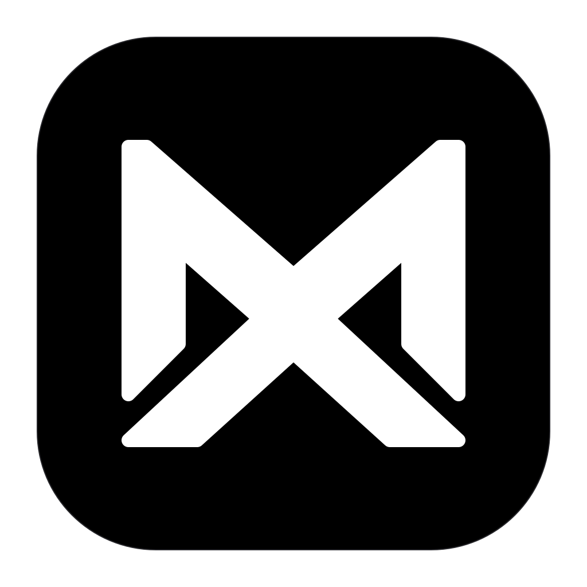
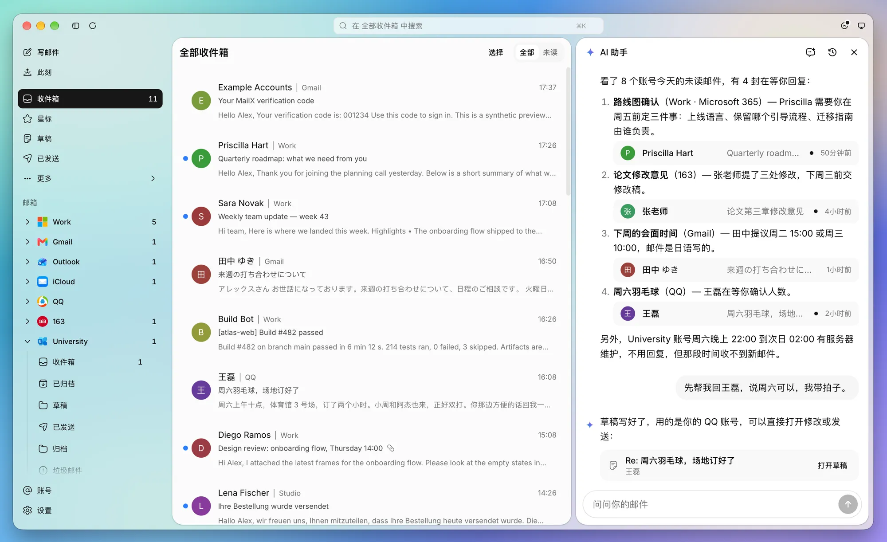
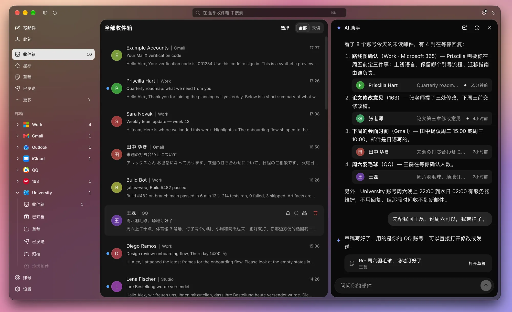
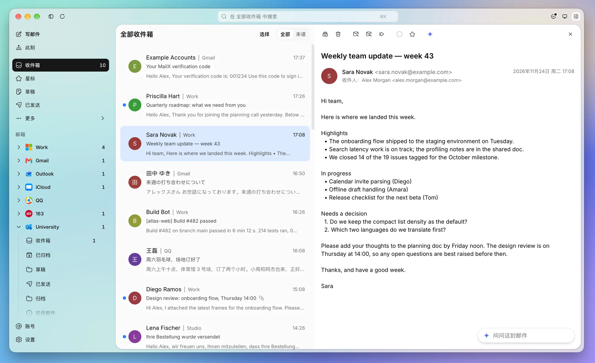
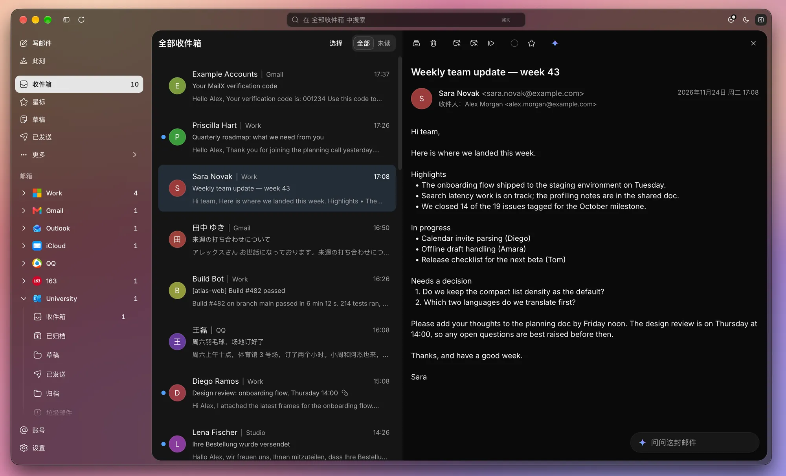
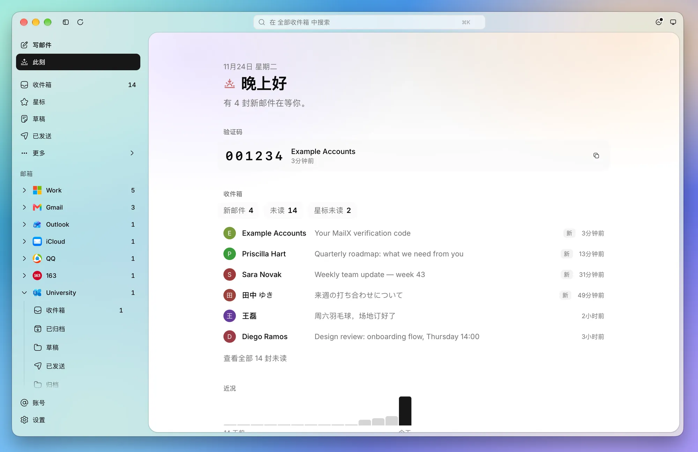
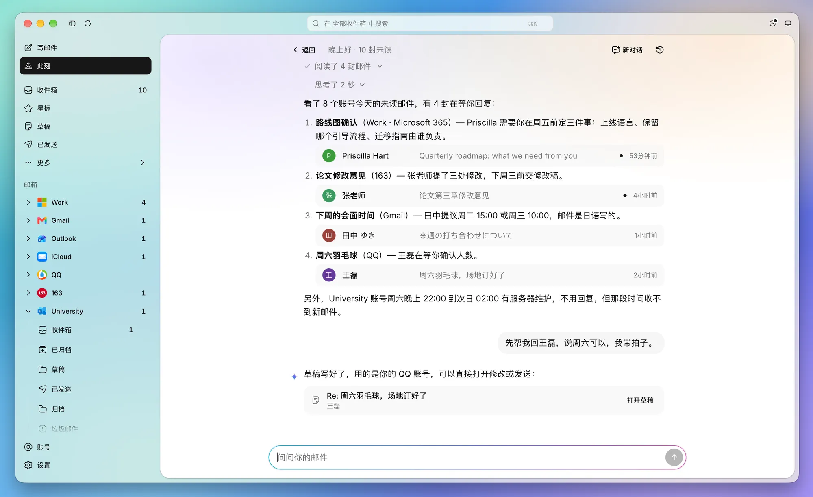
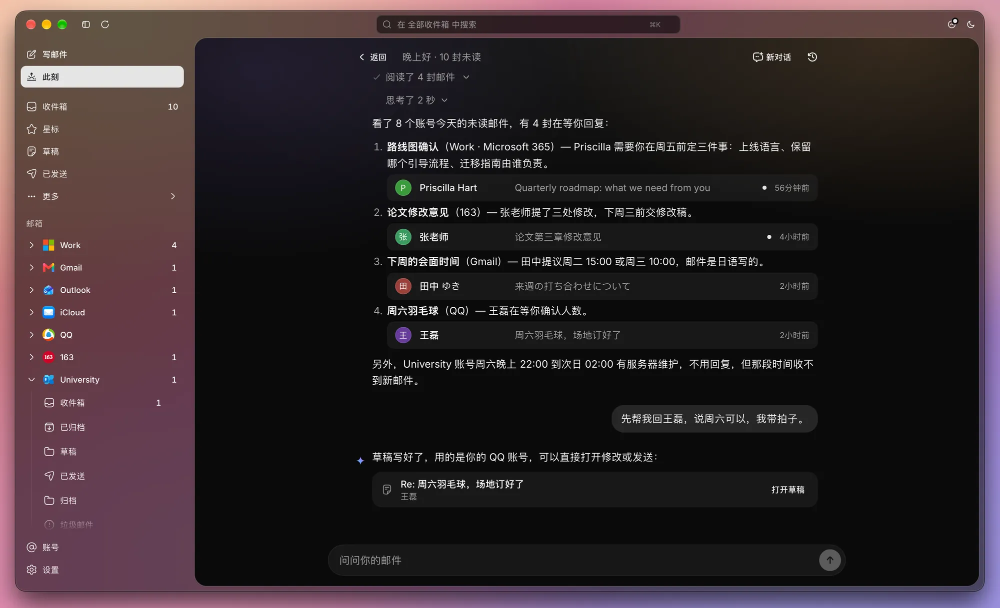
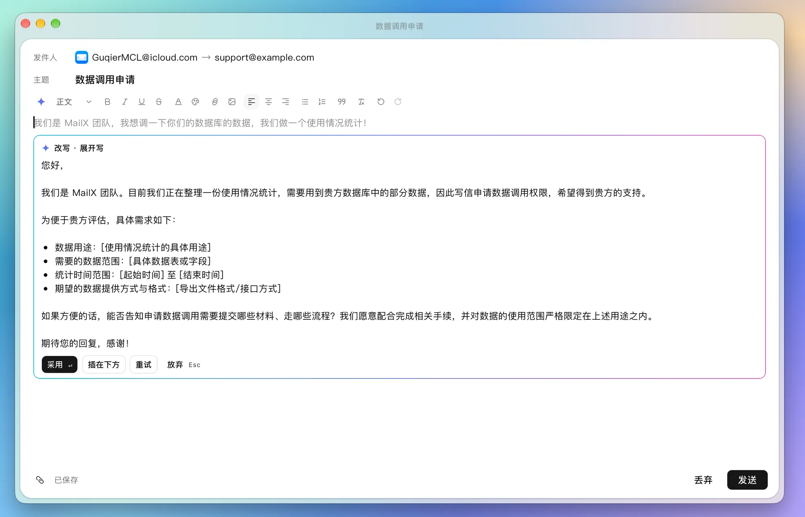
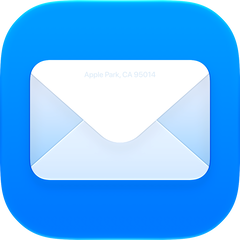

<div align="center">



# MailX

本地优先的 AI 原生邮件客户端——极速轻量，优雅聚合你的所有邮箱。

[](LICENSE)
[](https://github.com/GuqierMcl/MailX/releases)
[](https://github.com/GuqierMcl/MailX/releases)

[English](README.md) | 简体中文

</div>





## 特性

- **所有邮箱，一个收件箱** —— 多个账号汇入同一个收件箱。Gmail、iCloud、Outlook、Microsoft 365、自建 Exchange、QQ、163 等服务商开箱可加，其余支持 IMAP/SMTP 的邮箱手动填写服务器即可接入。
- **本地优先** —— 邮件、草稿和附件都存在你自己的电脑上，打开应用就是已经缓存好的内容。没有 MailX 账号，没有云端中转，不收集使用数据，搜索也全部在本机完成。
- **AI 原生** —— 内置助手直接在你的邮件上工作：跨所有账号找出今天需要回复的邮件、起草回复、归档整理。它会说明做了什么、引用具体邮件，动手之前先征求同意。不想用内置助手，也可以通过本地 MCP 把自己惯用的 AI 工具接进来。
- **极速轻量** —— Rust 核心运行在系统 WebView 上，不捆绑浏览器内核；打开应用直接进入本地缓存，不等待任何网络请求。
- **安全阅读** —— 正文在隔离的沙箱中渲染，够不到应用本身；远程图片默认不加载，等你允许。
- **写信与发送都可靠** —— 独立写信窗口支持富文本、附件和粘贴截图，草稿边写边存；每封邮件经过发送队列，可设置撤销、符合条件的失败自动重试，服务器可能已收到的邮件不会自动重发。
- **原位翻译** —— 打开即可翻译正在读的邮件并保留原版式，无需配置，或改用你自己的 DeepL、Microsoft、Google 密钥；你同意之前不会发送任何内容。
- **桌面原生体验** —— IMAP IDLE 让新邮件即时到达，配合系统通知与图标未读角标；支持后台运行、开机自启动、应用内更新、浅色深色主题与中英文界面。

## 截图

**读邮件**

| 浅色 | 深色 |
| :---: | :---: |
|  |  |

**此刻**

| 浅色 | 深色 |
| :---: | :---: |
|  |  |

**AI 会话**

| 浅色 | 深色 |
| :---: | :---: |
|  |  |

**写信与 AI 改写**

| 浅色 | 深色 |
| :---: | :---: |
|  |  |

## 支持的邮箱

下面这些邮箱服务经过兼容性与收发测试。选好服务，填入邮箱地址和服务商为客户端提供的密码、授权码或应用专用密码即可，服务器设置会自动填好；Outlook 和 Microsoft 365 改为在浏览器中登录。

<p align="center">
  
  
  
  
  
  
  
  
  
  
  
  
  
</p>

Gmail · iCloud 邮箱 · Outlook · Microsoft 365 · Exchange（自建服务器） · QQ 邮箱 · 163 邮箱 · 126 邮箱 · Yeah 邮箱 · 139 邮箱 · 新浪免费邮箱 · 飞书邮箱 · Lark 邮箱

不在此列、但支持 IMAP/SMTP 的邮箱，手动填写服务器同样可以添加。各服务的配置方式与前提见[添加账号指南](docs/guides/zh-CN/README.md)。

<sub>服务商名称与 Logo 为其各自所有者的商标，仅用于标识服务商。</sub>

## 下载

已发布构建位于 [Releases](https://github.com/GuqierMcl/MailX/releases) 页面：

| 平台 | 文件 |
| --- | --- |
| macOS（Apple 芯片） | `MailX_<版本>_macos-arm64.dmg` |
| macOS（Intel） | `MailX_<版本>_macos-x64.dmg` |
| Windows | `MailX_<版本>_windows-x64-setup.exe` |
| Linux | `.AppImage`、`.deb` 或 `.rpm`（`linux-x64`） |

macOS 安装包已使用 Developer ID 签名并公证，下载后可以直接打开。Windows 与 Linux 安装包尚未做代码签名，系统可能拦截首次启动，各版本发布说明里的安装说明介绍了打开方法。macOS、Windows 和 AppImage 版本可以在应用内自动更新。这些构建尚未在每个平台上逐一验证。

添加账号、发信、连接 MCP 与升级注意事项见[使用入门](docs/guides/zh-CN/README.md)。

### 从源码构建

环境要求：

- [Bun](https://bun.sh/)，版本以 [package.json](package.json) 中的固定配置为准
- 通过 rustup 管理 Rust，首次使用时按 [rust-toolchain.toml](rust-toolchain.toml) 自动安装指定工具链
- [Tauri 平台依赖](https://v2.tauri.app/start/prerequisites/)

```sh
bun install --frozen-lockfile
bun tauri dev       # 以开发模式运行桌面应用
bun run desktop:dev:isolated  # 同上，但使用独立的数据、密码与应用标识
# 无项目更新签名私钥时，构建当前平台未签名的本地安装包
bun tauri build --config '{"bundle":{"createUpdaterArtifacts":false}}'
bun run check       # 运行版本、类型、Lint、测试、构建与 Rust 检查
```

完整命令列表见 [docs/development/README.md](docs/development/README.md)。

## 隐私与数据

- **邮件保存在本地。** 邮件头、已下载的邮件、草稿和附件保存在本地数据库与文件中。没有 MailX 账号、云端中转，也不收集遥测数据；MailX 本身不加密邮件缓存。
- **密码存放在系统钥匙串** —— macOS 钥匙串、Windows 凭据管理器或 Linux 的 Secret Service —— 应用不会再把它显示出来。
- **连接由你控制。** 每个账号可以直连，也可以走自己的 SOCKS5 或 HTTP 代理，代理失败时直接停止，不会悄悄改为直连。MailX 连接你的邮件服务器，并在启动时和每小时向 GitHub 检查更新（自动下载可以关闭）；启用发件人头像查询或允许远程图片后，也会向相应的图片服务发起请求，头像查询默认关闭，远程图片默认先询问。
- **发出的邮件自带图片。** 插入正文的图片随邮件一起发出，显示这些图片无需从外部图片服务器下载。
- **翻译只在你要求时发送文字。** 同意之后，翻译邮件只会把它的主题和文字发送给你选择的服务，不发送其他内容；你自己的密钥保存在系统钥匙串中，可选的代理只用于翻译。已保存的译文留在这台电脑上。
- **AI 只在你同意后，把邮件发给你自己配置的服务商。** MailX 没有自带的 AI：助手、邮件摘要和写作帮助都使用你自己添加的模型服务商，第一次发送前会征求同意。同意后，你输入的内容，以及用到的邮件或草稿的正文、主题、发件人、收件人、日期和附件名称会发送给该服务商，附件里的内容和图片不会发送。助手回答时可能阅读多封邮件，仅限你允许的邮箱。打开 AI 设置时还会从 models.dev 下载公开的模型目录。API 密钥保存在系统钥匙串中，可选的代理只用于 AI；使用 Ollama 等本机模型时，邮件内容只发给这台电脑。对话和摘要保存在这台电脑上，可以在设置中撤回同意。
- **MCP 默认关闭。** 开启后，连接的本机客户端可访问所有账号、管理草稿、使用本机文件附件、导出邮件附件并直接发信，无需逐封确认。客户端可能把邮件内容转给其 AI 服务商。在设置中关闭 MCP 即可撤销访问；MCP 不能删除邮件。

## 已知限制

- 归档只在本机生效；移动到任意服务器文件夹、把本地草稿同步到服务器尚未实现，已发送的本机副本也不会上传。
- 首次同步从最近 30 天开始，每轮补齐各文件夹最新的一千封邮件头，已缓存的邮件会保留。搜索只覆盖本机内容，未打开过的正文可能不在结果中；附件按名称搜索，不搜索文件内容。
- Gmail 等其他服务商的浏览器登录，以及自托管的 Web 版本，仍在规划中。

## 文档

架构、开发与契约等设计文档以中文撰写；使用入门、参与贡献、安全政策与行为准则提供中英两版。

- [文档入口](docs/README.md)
- [使用入门](docs/guides/zh-CN/README.md)（[English](docs/guides/README.md)）
- [架构总览](docs/architecture/overview.md)
- [产品范围](docs/product/README.md)
- [AI 设计](docs/ai-runtime/README.md)
- [开发指南](docs/development/README.md)
- [路线图](docs/roadmap/README.md)

## 参与贡献

欢迎参与贡献。请先阅读 [CONTRIBUTING.md](CONTRIBUTING.md)（[简体中文](CONTRIBUTING.zh-CN.md)），并遵守[行为准则](CODE_OF_CONDUCT.md)（[简体中文](CODE_OF_CONDUCT.zh-CN.md)）。报告安全问题时请按 [SECURITY.md](SECURITY.md) 私下提交。

## 许可证

MailX 采用 [Apache License 2.0](LICENSE) 许可。

Copyright 2026 GuqierMcl and MailX contributors.

---

MailX 与 Unix 的 `mailx` 命令无关。
