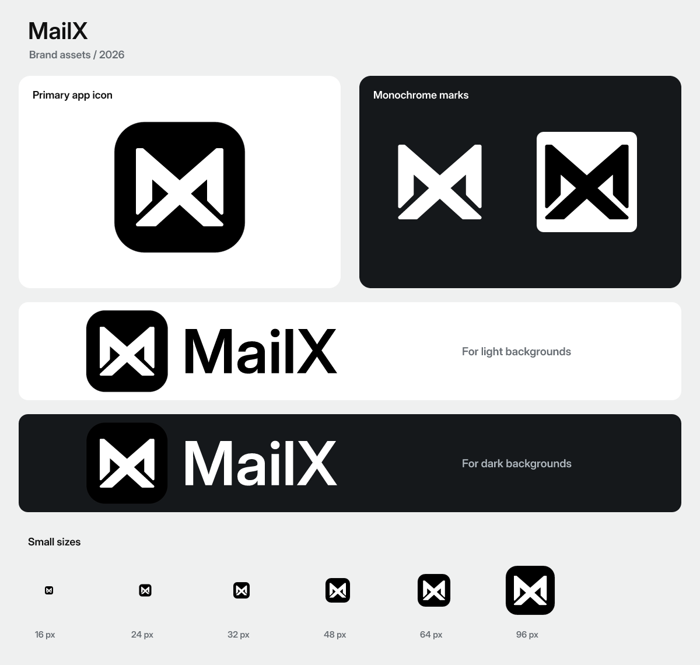

# MailX 品牌资源

正式主稿为 [logo.svg](logo.svg)，即维护者确认的优化版本。根目录旧稿与评审候选已移除，所有派生图标由这一份主稿生成。设计仍可随项目演化调整。



## 目录与用途

| 位置 | 资源 | 用途 |
| --- | --- | --- |
| `branding/logo.svg` | 1024 × 1024 主 Logo，透明外边距、黑色圆角底板 | 唯一需要维护的图形源稿；README、品牌展示 |
| `branding/variants/` | 满底色版、安全裁切版、黑白单色标记、纯字标、横版与竖版组合 | 文档、页头、关于页面、设计稿、宣传物料 |
| `branding/png/` | 主图标 16–2048 px、单色标记、透明背景组合 Logo | 不支持 SVG 的环境、截图、演示和导出 |
| `branding/social/` | 1200 × 630 Open Graph 图、1280 × 640 GitHub 分享图，均含深浅两版；400 / 1024 px 头像 | 网站分享、仓库社交预览、项目头像；尚未上传远程 |
| `branding/mobile/android/` | mdpi–xxxhdpi 的普通、圆形、背景、前景和单色图标，以及 adaptive-icon XML | 后续 Android 使用时的预备资源 |
| `branding/mobile/ios/` | Tauri 生成的 iPhone / iPad / App Store 常见尺寸，RGB 无透明通道 | 后续 iOS 使用时的预备资源 |
| `branding/fonts/` | 生成文字路径使用的固定 Inter 派生字体与 OFL 许可证 | 只用于离线生成，保证不同机器上的字标一致 |
| `desktop/icons/` | 多尺寸 `icon.ico`、`icon.icns`、PNG、Windows 商店图标、主稿副本 | Tauri 桌面窗口及未来安装包 |
| `desktop/icons/tray/` | 黑白透明图标 16 / 20 / 24 / 32 / 40 / 48 / 64 px；macOS template 22 / 44 px | 后续系统托盘功能 |
| `frontend/public/` | SVG / ICO / PNG favicon、180 px Apple Touch、Safari mask、主稿副本、Web manifest | 浏览器标签、网站收藏、当前页面 Logo |
| `frontend/public/pwa/` | 192 / 512 px 普通和 maskable 图标 | 未来 Web 安装入口与系统裁切 |
| `branding/generated-assets.json` | 每个生成文件的路径、字节数、SHA-256 与 PNG 尺寸 | 核对产物和发现过期资源 |

桌面和前端目录中的图标是构建所需的生成副本，不是第二套设计源稿。移动端、托盘和 PWA 文件的存在仅表示准备了素材：当前没有移动端工程、托盘实现或 Service Worker，不能据此宣称这些功能已经可用。

## 选择合适的版本

- **应用主图标**：使用 `logo.svg` 或 `png/app-*.png`，保留透明外边距和黑色圆角底板。
- **浅色背景上的组合 Logo**：使用 `logo-horizontal-black.svg` / `logo-stacked-black.svg`；`black` 指文字颜色。
- **深色背景上的组合 Logo**：使用对应的 `white` 版本；应用图标仍保留原有黑色底板。
- **只有符号、不需要底板**：使用 `mark-black.svg` 或 `mark-white.svg`。适合工具栏、托盘、单色印刷和水印。
- **只要名称**：使用 `wordmark-black.svg` / `wordmark-white.svg`。所有字标已转成路径，不需要接收方安装字体。
- **由系统裁切外形的场合**：使用 `app-maskable.svg` 或专用 maskable PNG。底色铺满，白色标记收在中心安全区，避免圆形裁切切掉图形。
- **iOS / Apple Touch**：使用专用满底色 PNG。iOS 文件不含透明通道，不把透明圆角桌面图标直接用于应用商店。
- **macOS 托盘**：`trayTemplate.png` 和 `trayTemplate@2x.png` 是黑色透明模板；未来接入时仍需通过宿主 API 启用 template 行为，文件名本身不会自动开启。

favicon 在不改变标记的前提下收紧了画布留白。它与完整桌面图标是同一设计的不同用途导出，不能用 favicon 反向覆盖主稿。

## 生成与检查

在仓库根目录执行：

```sh
bun install --frozen-lockfile
bun run icons:generate
bun run icons:check
```

`icons:generate` 使用本地固定版本的 `@resvg/resvg-js`、已安装的 Tauri CLI 与随仓库保存的字体，生成时不下载素材、不读取系统字体。桌面平台文件由 Tauri 编码，macOS ICNS 的块顺序会被规范化，以保证重复生成的结果稳定。iOS / Apple Touch 另行输出无透明通道的 RGB PNG。

`icons:check` 在临时目录重新生成，然后逐个比较文件内容；不会覆盖仓库中的图标。缺失、手工修改或源稿更新后未重新生成的资源会导致非零退出码。它是设计资源变更时的专项检查，不会拖慢每次前端构建。

主图形使用 SVG 中的独立 `<g>` 表达，便于导出透明单色标记。若以后重做 SVG 的画布或分组结构，同时调整 [生成脚本](../scripts/generate-icons.mjs) 的提取与布局规则即可。

资源有变动时还应执行 `bun run check`、`bun tauri build`，并检查真实窗口与浏览器下的显示。生成文件可以证明资源格式和尺寸；macOS、Linux、Android、iOS 的最终系统呈现仍需在相应平台验证。

## 已接入与后续使用

- Tauri 配置已引用正式 ICO、ICNS 和 PNG；`bundle.active` 保持关闭，生成图标不会启用安装包发布。
- 网页标题、favicon、Apple Touch、Safari mask、manifest 和模板页主 Logo 已接入。
- README 使用正式源稿。前端下方的 React / Vite 文档链接仍显示其各自标识，因为这些标识指向对应技术文档。
- 分享图保存在 `social/`，可在需要时上传 GitHub 的仓库社交预览设置；本轮没有修改任何远程仓库设置。
- Open Graph 图可以供未来站点使用；正式部署地址确定后再添加对应页面元数据，不预填不存在的公开 URL。

字体来源与生成记录见 [fonts/README.md](fonts/README.md)，许可证见 [fonts/OFL.txt](fonts/OFL.txt)。其余品牌资源随仓库的 [Apache-2.0 许可证](../LICENSE) 管理。

平台参考：[Tauri 图标工具](https://v2.tauri.app/develop/icons/)、[MDN 应用图标说明](https://developer.mozilla.org/en-US/docs/Web/Progressive_web_apps/How_to/Define_app_icons)。
