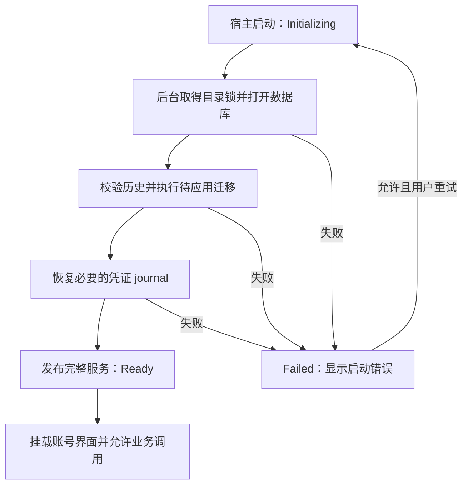

# 应用数据库版本化迁移与启动

状态：**Implemented（迁移与启动准入）**。应用启动时自动完成本地数据库准备，成功后才开放业务界面和账号操作；覆盖 v1 兼容、有序迁移、启动准入和失败重试。当前生产清单为 v1–v10：v2 文件夹、v3 邮件头、v4 正文缓存、v5 账号颜色、v6 待写回标记、v7 草稿 / 发件人名称、v8 发送队列、v9 草稿 HTML，以及 v10 代理图片域名解析策略。`0010_image_proxy_dns.sql` 为 `network_routes` 增加默认 0 的 `image_proxy_dns`，约束非 custom 路由不得启用；既有账号升级后保持受限策略。历史 SQL 字节不变，旧配置快照缺少该字段时也默认关闭。邮件联网在启动准入后进行。备份恢复与完整升级保障仍是后续工作。

## 1. 目标与范围

数据库是 MailX 自己的应用数据库。生产路径继续由 Tauri `app_data_dir()` 提供，核心接受宿主注入的 user-data-dir；数据库名、应用 identifier 和系统凭据归属均沿用现有配置。

本轮实现：

- 不可变的编号 SQL、显式有序迁移清单、历史校验及逐步事务执行。
- 已有 v1 数据库兼容，新数据库自动初始化，重复启动不重复执行迁移。
- 桌面启动主动准备核心；前端和后端都以核心就绪为业务准入条件。
- 简洁的 shadcn 启动中、失败和重试界面，以及必要的核心行为验证。

本轮暂缓：迁移前备份、备份恢复入口、完整历史升级和故障注入矩阵、损坏数据库修复、自动降级、迁移取消及进度百分比。邮件连接、同步、发送和 OAuth 授权不属于本方案的实现范围。

目录锁、checksum、拒绝更高版本数据库和事务原子性继续作为核心语义保留。逐步事务不等于整次升级回滚，也不替代未来的备份方案。

## 2. 参考与取舍

以下结论来自固定提交的公开源码审阅，不是这些项目的运行验证：

| 参考 | 已观察的设计 | MailX 的取舍 |
| --- | --- | --- |
| [DBX 启动界面](https://github.com/t8y2/dbx/blob/a7d6b80e2cdbec2a3a8b8c62b9f31498eaefeee4/apps/desktop/src/StartupGate.vue#L14-L28)、[业务 IPC 拦截](https://github.com/t8y2/dbx/blob/a7d6b80e2cdbec2a3a8b8c62b9f31498eaefeee4/src-tauri/src/migration_gate.rs#L52-L64) | 安全迁移完成前不加载业务 App，后端另行拒绝业务命令 | 采用界面与后端共同控制准入；其凭证迁移向导、备份流程不引入本轮 |
| [DBX 表结构初始化](https://github.com/t8y2/dbx/blob/a7d6b80e2cdbec2a3a8b8c62b9f31498eaefeee4/crates/dbx-core/src/persistence/storage.rs#L2489-L2517) | 建表后检查字段，按需补列 | MailX 使用明确的版本序列，避免把字段存在性检查作为通用迁移历史 |
| [Yaak 迁移器](https://github.com/mountain-loop/yaak/blob/277bbe1baa9bba6f4dfe166a1ff9b1ba2c1f5331/crates/yaak-models/src/migrate.rs#L9-L65)、[数据库插件初始化](https://github.com/mountain-loop/yaak/blob/277bbe1baa9bba6f4dfe166a1ff9b1ba2c1f5331/crates-tauri/yaak-app-client/src/models_ext.rs#L132-L161) | rusqlite、编译嵌入的编号 SQL、逐步事务；初始化成功后发布服务 | 沿用 rusqlite 和核心自持存储；保留 MailX 的 checksum 与更高版本拒绝策略，不采用 Yaak 放宽历史校验的做法 |
| [Tauri 官方 SQL 插件](https://github.com/tauri-apps/plugins-workspace/blob/738c323cfc41fc1bb248991de9620383de788d4d/plugins/sql/src/lib.rs#L168-L240) | `preload` 在插件初始化时等待迁移，失败返回启动错误 | 采用启动时准备服务的原则；本轮不引入 SQL 插件，不向前端开放 SQL，也不改用其默认的 app-config 目录 |

宿主负责启动顺序与界面准入，core 负责数据库生命周期。迁移模块不依赖 Tauri，未来其他宿主可以复用同一入口。

## 3. 模块职责与文件组织

当前布局如下：

```text
core/src/storage/
  mod.rs                               # 目录锁、连接配置与存储操作
  migrations.rs                        # 有序清单、历史检查、事务执行
  migrations/
    0001_account_configuration.sql     # 现有 schema.sql 原样迁入
    0002_*.sql                         # 以后真实变更时追加，本轮不创建
desktop/src/
  state.rs                             # 启动状态、服务所有权、单次初始化/重试
  commands.rs                          # 状态接口、业务准入及既有来源检查
frontend/src/features/startup/
  ...                                  # 启动状态展示，Ready 后挂载业务页面
```

迁移描述由 Rust 静态清单提供：`version`、`description`、`sql`，并声明该版本完成后必须存在的业务表。SQL 使用 `include_str!` 嵌入二进制，校验值按当前原始 UTF-8 字节计算 SHA-256。清单从版本 1 开始连续递增，禁止重复、乱序或缺号；运行时验证清单，不通过悄悄排序掩盖错误。

新增迁移必须同时新增 SQL 和清单条目。运行时不扫描磁盘 SQL 目录，不下载迁移，不接受前端提供的 SQL、文件路径或目标版本。显式修改 Rust 清单使新增文件进入编译依赖。

## 4. 版本与执行规则

### 4.1 沿用 v1 记录格式

继续使用当前两处记录：

```sql
PRAGMA user_version;
SELECT version, checksum FROM schema_migrations ORDER BY version;
```

`schema_migrations(version, checksum)` 是已执行历史，`user_version` 是末个已提交版本；两者必须一致。描述暂存静态清单，本轮不为增加时间、描述或耗时字段制造一个没有业务必要性的 v2。

现有 `schema.sql` 原字节迁入 `0001_account_configuration.sql`，包括空白和换行。保留原 checksum 算法，不重新格式化、正规化或重写初始 SQL。v1 SQL 已包含创建 `schema_migrations` 的语句，执行器不能提前创建同名表。

数据库版本与应用发布版本、账号 `revision`、凭证 `generation` 分别管理。一次程序发布可以没有数据库迁移。

### 4.2 打开数据库

1. 校验内置迁移清单，取得 user-data-dir 的现有独占锁，再打开数据库。
2. 启用连接级外键与 busy timeout，读取 `user_version` 和可用的迁移历史。
3. 版本为 0 且不存在用户定义的 schema 对象时，认定为空库；非空无版本数据库拒绝打开，不自动接管或重建。
4. 已有库的历史必须恰好等于内置清单的一个完整前缀：版本和 checksum 逐项相同，末项等于 `user_version`。更高版本、未知版本、缺项、缺表、校验不符或两处版本不一致，均返回 `storageIncompatible`。
5. 完整历史通过检查后，设置并核对 WAL / FULL，按清单执行余下迁移。所有已应用项先校验完，再开始新迁移。
6. 存储准备成功后，继续已有 `AccountService::open` 的凭证 journal 恢复；全部必要准备成功才返回服务。

checksum 证明迁移文件与已记录历史一致，不代表已经检测出所有人为改表或数据库损坏。完整结构审计和健康检查不在本轮内。

### 4.3 每步迁移

每一步使用一个 `IMMEDIATE` 事务：执行 SQL → 写入该版本及 checksum → 更新 `user_version` → 提交。空库的第一步在同一事务内创建业务表和迁移表，再写入版本 1。

任一步失败，回滚该步的结构、数据、历史记录和版本更新，停止初始化。前面已提交的步骤保留；下次启动重新核对历史，再从尚未执行的步骤继续。这不承诺退回整个升级之前的版本。

迁移 SQL 只负责该版本的结构或数据变更，不得自行 `BEGIN` / `COMMIT` / `ROLLBACK`，不得自行改写迁移历史和 `user_version`，也不得关闭外键、执行不能纳入该事务的 `VACUUM` 等操作。v1 创建历史表是兼容现有数据库的明确特例。迁移不读写 SecretStore、不访问网络；未来涉及秘密格式变化时另行设计跨存储协议。

发布后只追加迁移，不修改旧 SQL。后续若改变持久化 journal 的结构，还必须兼容或迁移旧 journal 内容，不能只改业务表后让启动恢复无法读取已有意图。

## 5. 桌面启动与服务所有权

Tauri 宿主在启动装配时立即建立 `Initializing` 状态并主动启动准备任务；无需前端请求来触发。应用窗口可以先显示启动页，账号界面保持未挂载。只在应用 `setup` 中派发任务后立即返回，不足以保证业务未提前进入，因此必须实现明确的状态控制。



`AccountService::open` 和所有 SQLite / 凭据库操作在阻塞工作线程运行。状态查询使用短时状态锁，不等待初始化持有的长时间锁；只有完整服务可用时才原子发布 `Ready` 与服务引用。业务执行继续串行访问同一个服务。

`Ready` 表示本地核心完成必要准备，不表示邮箱联网、密码有效或系统凭据库以后永远可用。已有 journal 中不影响配置可用性的旧凭证延迟清理失败，继续采用当前非阻断语义；不增加“启动时读取全部密码”的全面凭据探测。必要 journal 恢复遇到凭据库不可用时进入 `Failed`，解锁后可以重试。

### 状态转换与重试

| 状态 | 服务与调用规则 | 允许的后续变化 |
| --- | --- | --- |
| `Initializing` | 不暴露半初始化服务，业务 IPC 立即拒绝 | `Ready` 或 `Failed` |
| `Ready` | 唯一服务持有目录锁；业务可调用 | 本轮运行期间不重新初始化 |
| `Failed` | 本次临时连接与目录锁在工作结束后释放，保存脱敏错误 | 允许的手动重试转为 `Initializing` |

同一进程最多一个初始化任务。状态切换和任务派发由宿主协调；重复重试请求在 `Initializing` 时返回当前状态，在 `Ready` 时也只返回状态，不再打开数据库。任务执行完成或确认失败前，不允许启动下一次尝试；后台任务 panic / JoinError 也必须转为 `Failed`，不能永远显示加载。

普通账号命令不再懒初始化，不排队等待启动完成后悄悄执行。退出时不派发新重试；服务与目录锁遵循进程生命周期释放，不靠删除锁文件解除占用。

## 6. 启动 IPC 与前端边界

以下接口已使用现有 `ApiResult<T>` 封装并注册到 Tauri；`StartupStatus` 与错误类型由 core 生成 TypeScript 契约，状态转换和服务所有权仍由 desktop 管理。

| MailxClient 方法 | Tauri 命令 | 行为 |
| --- | --- | --- |
| `getStartupStatus()` | `app_get_startup_status`，无参数 | 返回当前快照，不触发初始化 |
| `retryStartup()` | `app_retry_startup`，无参数 | 按状态允许启动一次重试，立即返回当前快照，不等待迁移完成 |

快照采用互斥类型，`revision` 在当前宿主进程内每次状态转换单调递增：

```ts
type StartupStatus =
  | { state: "initializing"; revision: number }
  | { state: "ready"; revision: number }
  | { state: "failed"; revision: number; error: AppError; canRetry: boolean };
```

`Failed` 是成功取得的启动状态，不是状态查询本身通信失败。`canRetry` 由宿主决定：读写暂不可用、目录被占用、凭据库暂不可用等错误允许用户处理原因后重试；历史或版本不兼容不提供原地重试，也不提供跳过迁移按钮。即使客户端直接调用重试命令，`canRetry=false` 时也只返回原状态，不派发任务。任务异常按固定 `internal` 错误处理，可手动重试；没有自动循环重试。

两个启动命令与账号命令一样，只允许本地可信 main 窗口，沿用 URL / capability / 参数解析检查。业务准入放在共用宿主执行入口，四个账号命令全部覆盖：`Initializing` / `Failed` 返回 `coreNotReady`；前端通过状态接口获取原因。来源校验在准入检查前执行。客户端不能自报 Ready、选择目录或访问迁移表及 SQL。

前端启动边界先查询快照，只在 `Initializing` 时以约 500 ms 间隔继续查询，同时最多一个状态请求在途；达到 `Ready` 或 `Failed` 后停止。重试命令返回 `Initializing` 后恢复轮询；如果重试响应丢失，先重新查询快照，不盲目再次派发重试。查询传输失败显示通信错误并提供再次查询，不误报迁移失败或就绪。旧响应按 `revision` 丢弃；组件卸载使在途响应失效。WebView 刷新重新读快照，不能重新触发建库。本轮不增加依赖一次性事件的通知机制。

`Ready` 前不挂载账号页面、不执行账号列表 effect；启动页由 shadcn 组件组成，不显示假进度。失败页展示固定脱敏原因、按 `canRetry` 显示重试操作，用户也可关闭窗口退出。界面不展示 SQL、原始错误堆栈、绝对路径、凭证或账号内容。普通浏览器保持宿主不可用提示，不启动无效轮询或模拟持久化。

以后增加同步、发送、MCP 等后台任务时，也须在同一 Ready 条件满足后启动；本轮不创建这些任务。

## 7. 实施顺序与基本验收

实施顺序：先迁移模块及 v1 兼容，再宿主主动初始化和业务准入，随后接入生成的启动 DTO / IPC 与前端启动边界，最后同步实际行为文档。当前账号读写语义保持不变。

| 基本验收 | 要证明的结果 |
| --- | --- |
| 新目录启动 | 自动按生产清单建库，核心就绪后才开放业务页面 |
| 已有 v1 启动 | 使用保留的 v1 样本及合成账号，原 checksum、账号 ID、配置、凭证引用和待恢复 journal 保持兼容 |
| 多步与重复启动 | 测试清单验证按序执行与重开不重复；生产清单只因实际结构变更追加版本 |
| 失败步原子性 | 一例中途失败证明该步 SQL、历史行和 `user_version` 同时回滚，之前步骤保留，后续步骤不执行 |
| 历史拒绝 | 现有 checksum / 更高版本保护继续通过，并检查历史缺项或两处版本不一致时不会继续迁移 |
| 启动准入 | 可控的慢初始化和失败状态下，账号组件未挂载，直接业务 IPC 也不能调用服务；成功后才可用 |
| 重试与刷新 | 并发点击只有一个任务；状态查询保持响应，异常可进入 Failed，WebView 刷新不重复初始化 |

上述是迁移执行器及启动边界的最小正确性验证，不是完整的历史升级、平台或灾难恢复矩阵。测试使用独立临时目录和合成数据；已有真实用户数据库不作为测试输入。实际实现完成前不标记这些验收已通过。

## 8. 后续扩展

一致性备份与恢复、版本发布升级矩阵、数据库损坏诊断、长迁移进度及大数据量性能另行设计。不得把本轮逐步事务成功表述为“已具备完整升级保障”。相关长期要求仍见[存储与搜索](storage-search.md#6-迁移与恢复)；凭证恢复遵循[账号配置的一致性协议](account-configuration.md#4-sqlite-与凭据库的一致性)。
