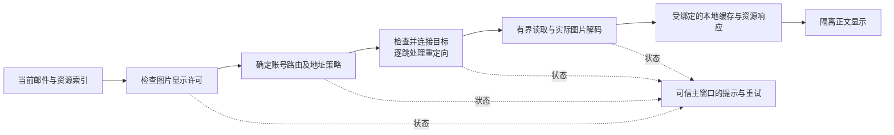

# 远程邮件图片：项目调研与优化方案

状态：**Implemented（A/B 与格式扩展已有代码和自动验证；真实代理矩阵待补）** · 2026-10-25。当前实现覆盖兼容与诊断、标准代理路径，保留单一“不再提示”，不增加发件人粒度许可。本文保留研究证据，当前契约见[网络与安全](network-security.md)，执行证据见[验证策略](../development/validation.md)。

推荐保留 Rust 获取图片、隔离正文显示的架构，把资源授权、账号路由、目的地址策略、图片解码和失败反馈分开。优先解决真实图片被 MIME 标签误拒绝、单地址连接、代理域名请求被一律拒绝及失败不可诊断的问题。持续添加代理软件的 Fake-IP 网段不能成为长期兼容方案。

## 1. 研究范围与结论

调研日期为 2026-10-25，采用官方文档和下列固定源码快照；没有运行这些第三方项目的完整兼容矩阵。主分支代码不等于全部已发布版本。Thunderbird 与 Gecko 分别检查了各自的主分支快照，不能当成精确配对的发行版本。

| 项目 | 固定提交 | 核查范围 |
| --- | --- | --- |
| Thunderbird 桌面 | `da0dd1d2b1e23859609d23043fb6a9852bb0ca9a` | 远程内容许可、代理设置、邮件内容策略 |
| Gecko | `efd2d1e6f77570ae6bc5294731a68101e45c81a3` | 图片请求与实际类型识别、代理 DNS |
| FairEmail | `8f486274b273389d5a6c2db28015f84fc34180aa` | 重排正文的原生图片获取与解码、许可、代理 FAQ |
| Thunderbird Android / K-9 | `de8a03268415ce8e0c8b0327d3bbcb6b40a06a91` | legacy 阅读器的 WebView 请求路径 |
| Nextcloud Mail | `6d7df9bb001635f1c2eca36ad356edfc4177ae09` | 图片代理、邮件授权绑定、显示许可 |
| Nextcloud Server | `210c6b573e477a27fd7d2cee2e154f4bc7777d60` | 平台 HTTP 客户端、DNS 固定与代理配置 |
| Roundcube | `42ac0e3ef5dfc4b8b32bb15512af2a4390e64bf1` | 核心 HTML 清理与远程资源授权；不含第三方插件 |

| 项目 | 实际做法与证据 | 对 MailX 的启发 |
| --- | --- | --- |
| Thunderbird / Gecko | 默认阻止远程内容，可按消息、发件人或图片来源允许；网络层处理系统代理、PAC、HTTP/SOCKS 和远端 DNS；图像层通常先识别实际字节，再回退到响应类型。[内容许可][tb-policy]、[代理设置][tb-proxy]、[图片识别][gecko-sniff] | 授权、网络、解码是不同职责。兼容错误 MIME 不必弱化 TLS 或允许任意目标。 |
| FairEmail | 重排正文路径通过 `HttpURLConnection` 下载，然后由 Android 解码器读取；不要求栅格 Content-Type 与实际格式一一匹配；未授权、加载中和网络失败有不同占位。[下载与解码][fair-image]、[状态反馈][fair-state] | 基于真实图片解码做兼容，同时让用户知道阻止或失败原因。 |
| Thunderbird Android / K-9 | 默认阻止 WebView 网络，点击显示后解除；该请求拦截器仅接管 CID，其余资源交由 WebView。[网络开关][k9-webview]、[请求拦截][k9-intercept] | 平台网络栈承担大量兼容工作；MailX 借鉴这种分工，但不能直接依赖 WebView 绕开账号路由。 |
| Nextcloud Mail | 资源改写到服务器代理，校验邮件访问权和 URL HMAC；控制器取回字节后以通用 MIME 返回，未在此处解码图片。[授权绑定][nc-proxy] | MailX 已有的文档 token、资源索引与身份重检值得保留；不应开放任意 URL 下载接口。 |
| Nextcloud Server | HTTP 层解析目标，任一地址为本地地址即拒绝整组，通过后固定地址；支持实例级代理。[DNS 中间件][nc-dns]、[客户端][nc-client] | 严格地址策略在成熟项目中确实存在。“筛掉不允许地址、连接剩余地址”是本项目的改进建议，并非业界已经一致采用。 |
| Roundcube | 核心路径在允许远程资源后保留原 URL，由浏览器获取；默认询问，可配置联系人/可信发件人等许可。[URL 清理][rc-url]、[默认配置][rc-config] | “别的邮件客户端能显示”可能源于不同的请求主体，不能直接证明 Rust 下载器可以删除地址限制。 |

这些项目也有不适合移植的选择：FairEmail 的图片 HTTP helper 存在关闭主机名校验的配置分支，MailX 不采用；其 FAQ 表示应用内代理已移除，转而推荐 Android VPN-Service，这是该项目的平台取舍。[TLS helper][fair-tls]、[代理 FAQ][fair-proxy]。Mailspring 官方同样没有承诺操作系统网络层之上的代理配置支持，不能将其当成通用代理兼容的成功例证。[Mailspring 官方说明][mailspring-proxy]

本文不宣称上述项目全部拒绝内网、全部不携带 Cookie/认证信息，或已兼容任意 Fake-IP。Thunderbird 的可信域名配置还明确考虑企业内网内容；这种内容许可不等于对代理最终地址的证明。[企业域名说明][tb-intranet]

## 2. 调研时的 MailX 问题

当前阅读链路为：净化邮件 → 生成当前文档的图片资源索引 → Rust 按账号路由取图 → 有界解码 → 本地资源协议 → sandbox iframe。正文不能取得任意下载或 Tauri IPC 能力。这一结构适合保留。

| 现状 | 用户影响 | 处理方向 |
| --- | --- | --- |
| DNS 地址必须全部通过，且仅连接第一项 | 混合地址或 IPv6 不可达时，即使存在可用候选也可能失败 | 筛选允许候选、固定实际连接地址、多地址回退 |
| 自定义代理下，域名图片直接拒绝 | IMAP/SMTP 代理可用，不代表同账号的域名图片可用 | 独立建模“代理解析目标”的信任策略 |
| Fake-IP 依赖已知网段例外 | 代理切换网段后仍可能失败 | 标准 SOCKS5/CONNECT 域名隧道成为主要兼容路径 |
| 支持的栅格 MIME 之间已能纠错，但缺失类型或 `application/octet-stream` 仍拒绝 | 真实 PNG/JPEG 仍可能被 CDN 的通用响应标签挡住 | 接受常见模糊类型后执行完整解码 |
| 网络及格式错误大多归为 `NotFound`，协议返回 404 | 已点击“加载图片”仍只能看到破图，难以排查 | 在可信主窗口提供固定错误分类与重试 |
| “不再提示”保存为全局 `automatic` | 用户选择保留简单交互 | 保持现有行为，不增加发件人/域名权限层级 |

本轮已有局部修复覆盖 IPv6 `2001:2::/48` 的 HTTPS 域名 Fake-IP 和受支持栅格类型之间的响应头误标，不能据此宣称所有代理或 CDN 已兼容。

调研时 `core/src/app/bodies.rs` 已读写磁盘图片缓存，TTL 为 30 天，旧键为 `remote:{url}`，并非只有内存缓存。本轮已纠正文档并按账号、来源与连接版本划分新缓存。`core/src/app/avatars.rs` 复用同一下载器，网络改动也要覆盖头像，但头像开关与正文图片许可继续独立。

## 3. 采用的设计

### 3.1 直连：只尝试通过检查的地址，支持多地址连接

一次解析后形成去重、数量有界的候选集，剔除不允许的地址；没有候选时明确返回目标受限。连接器只能使用这份候选集，不得再次按原域名解析或偷偷换出口。重定向后对新目标重新执行同样流程。

对 IPv4/IPv6 使用 Happy Eyeballs 式连接：优先地址族迟迟不通时，约 300ms 后尝试另一地址族；同族地址失败后继续下一候选，成功即取消其余尝试。保留统一总时限，不能让每个候选各自耗满 30 秒。候选过滤允许“一个拒绝、另一个可用”成功，但被拒绝的地址永不进入连接器。

首选在当前 Hyper 栈中验证 `hyper-util::HttpConnector` 的受控 resolver 和多地址连接能力；其公开 API 已提供自定义 resolver、连接超时和 Happy Eyeballs 配置。需要新增对应 Cargo feature，并通过集成测试证明没有第二次 DNS 或绕过路由。TLS 继续由现有平台证书验证完成。[HttpConnector 官方文档][hyper-connector]

不为这次问题整体迁移 IMAP/SMTP/HTTP 网络库。换成通用 HTTP 客户端也不会自动解决账号路由、代理最终地址或图片授权问题。连接回退限于相同路由的合格地址；证书验证失败明确报错，不以关闭验证处理。

### 3.2 代理：区分本地可校验的目标与代理代解析的目标

建议按账号保存以下两种图片网络策略，既有账号迁移后沿用当前受限策略。

| 策略 | DNS 与连接行为 | 适用范围 |
| --- | --- | --- |
| 受限地址策略（默认） | 直连时检查并固定候选 IP；保留现有 HTTPS 域名的已知 Fake-IP 例外；代理域名请求仍拒绝并给出明确原因 | 未选择代理代解析的桌面账号；未来服务器宿主应默认更严格，不自动继承桌面 Fake-IP 例外 |
| 使用已配置代理解析图片域名（新增、显式启用） | HTTPS 图片把原域名交给该账号 SOCKS5 或 HTTP CONNECT 代理；不在本地查询图片目标域名；TLS 验证原域名 | 用户自行配置且信任的桌面代理出口 |

后者可在账号代理设置中选择一次，无需每封邮件重复确认，也不隐含授予图片显示许可。选择只绑定当前代理配置版本，代理端点变化后撤销该选择；已有“全局自动加载”不等于允许新的网络策略。配置文字应说明由代理解析和连接图片服务器，应用无法独立验证代理最终连接的 IP。

标准 SOCKS5 / CONNECT 无法向客户端可靠证明最终目的地址。**TLS 可以确认原域名身份，不能证明地址属于公网。** 新策略意味着将部分目的地址控制交给受信代理，不能描述成与本地 DNS 固定完全等价。对于图片 URL 中的私网 IP 字面量、localhost 等明确本地目标仍拒绝；名称过滤本身不构成完整的内网防护。配置好的本机代理端点可以是 loopback，不能与邮件提供的目标地址混为一谈。

首版新增代理域名路径限于 HTTPS。对符合现有升级条件的 HTTP 图片先尝试 HTTPS，失败后给出明确状态，不向受信代理发送该域名的明文 HTTP 请求；普通直连公网 HTTP 的既有行为单独保持。每次重定向继续检查 scheme、userinfo、目标与策略，HTTPS 不降级。代理失败绝不回退直连，代理认证只用于隧道，邮箱凭证不参与图片请求。这里禁止本地解析的是图片目标域名；配置为域名的代理端点本身仍需按路由约定定位。

### 3.3 Fake-IP 的兼容范围要如实表达

Mihomo 支持配置 IPv4/IPv6 Fake-IP 段，官方示例含 ULA IPv6；sing-box 也允许分别设置两个地址段。[Mihomo DNS][mihomo-dns]、[sing-box FakeIP][singbox-fakeip]。所以仅维护 `198.18.0.0/15` 和 `2001:2::/48` 无法覆盖任意用户配置。

推荐让提供 SOCKS5/HTTP 入口的代理通过 3.2 的标准域名隧道工作，从而避免 MailX 依赖其 Fake-IP 范围。只有 TUN、使用未知私网 Fake-IP 且没有可用代理入口时，首版仍可能受限；提示用户调整网络配置，而不是静默放开全部私网。

后续若确有仅 TUN 的需求，再设计受账号/网络配置约束的自定义映射范围；不能仅因检测到 VPN 网卡、代理进程或 TLS 成功就自动认可任意私网。企业内网图片另行设计精确域名/端口范围与管理入口，不与“信任发件人”合并。系统代理、PAC 自动发现也不在首版范围，避免不透明地改变账号出口。

### 3.4 图片验证：对标签宽容，对实际内容严格

远程图片以真实内容识别格式，不以 Content-Type 或 URL 后缀决定准入；即使响应头标为 text/html，只要实际字节是受支持且完整解码通过的图片，也只输出图片。真实 HTML 错误页、损坏、截断和超预算输入仍拒绝。

栅格支持 PNG/APNG、JPEG、GIF、WebP、ICO、BMP、TIFF、PNM、QOI、DDS 的 DXT 变体、Radiance HDR、Farbfeld、带 v2 尾签名的 TGA。JPEG 完整验证后保留压缩字节，其他格式转静态 PNG，APNG 显示默认图像。SVG 可以从实际 XML 识别，但必须具有标准命名空间和 SVG 根元素，再经受限渲染器转 PNG；不向正文提供原始 SVG，不加载外部资源。CID/data 保持独立的声明类型规则。

本轮不增加 AVIF/HEIF/JXL：现有解码栈没有可直接采用的统一支持，AVIF 需额外原生依赖。OpenEXR 暂缓，内部解压分配不能可靠继承当前预算。首版继续请求 identity 编码；若以后增加 gzip/br，需要同时约束压缩输入与解压后大小。

下载输入上限 8 MiB，规范化输出上限 16 MiB，最多 4 个下载、4 个解码工作，最多 3 次重定向，包含排队的网络等待预算 30 秒。栅格边长最多 8192，解码分配与输出像素分别受 64 MiB 限制；这是解码预算，不是整个进程峰值内存承诺。当前阅读成功图片累计最多保留 64 MiB，超限报告明确原因；这样重试可在磁盘缓存不可用时仍保留成功资源。阻塞解码持有自己的许可，网络超时或取消不会提前释放其工作槽。

### 3.5 失败反馈、重试和缓存

下载器保留固定的内部分类：目标受限、代理策略未启用、DNS 失败、连接失败、代理失败、TLS 失败、HTTP 状态失败、类型不支持、图片损坏、预算超限、超时、取消。未授权的请求在下载前拒绝。受限资源协议对 iframe 继续返回不披露细节的失败响应；可信主窗口通过绑定当前文档 token 的状态快照获取每个资源索引的状态，不接受前端提交任意 URL。

阅读区显示例如“3 张图片未能加载 · 网络连接失败”，附“重试图片”按钮。状态接口仅返回资源索引、加载中标志和固定错误码，不携带完整 URL、查询参数、服务器响应、Cookie、代理认证或邮件内容。正常加载不增加提示。

重试只针对当前仍获许可的失败资源，重新检查账号和策略；合并同一资源的并发请求，并设置短冷却，避免自动无限重试和重复跟踪请求。重试新文档继承当前绑定中所有成功图片的内存，换发独立令牌并撤销旧令牌；磁盘缓存被清理或写入失败也不会重新访问成功的图片源。策略拒绝和 TLS 失败不做无提示自动重试，也不生成长时间通用失败缓存。

开放新的代理策略前，将远程缓存键扩展为账号、路由/策略版本、完整资源 URL 摘要及解码版本，防止不同出口获取的同名资源互相复用；不擅自去掉 URL 查询参数。缓存命中仍检查当前文档与许可，收紧策略、切换路由、撤销账号后旧任务不能回填可读状态。旧的全局 URL 缓存不直接迁移到新的受信策略空间。暂沿用现有容量和 TTL，不照搬 Nextcloud 的长期浏览器缓存。

### 3.6 显示许可：保留“不再提示”

用户明确选择保持简单交互：本次点击加载只授权当前阅读；勾选“不再提示”后加载，成功保存全局 automatic 才放行；设置里仍可选择每次询问或永不加载。不增加发件人、域名或账号级显示许可列表。该选择独立于账号代理的网络策略，头像仍受自己的开关控制。

其他项目的细粒度许可仅作为研究事实保留，不再列为本项目实施阶段。[Nextcloud 显示许可][nc-permission]、[Thunderbird 帮助][tb-help]

## 4. 实施顺序与验收

| 阶段 | 主要改动位置 | 完成条件 |
| --- | --- | --- |
| A：兼容与可诊断 | `core/src/net/images.rs`、正文资源状态/IPC、`frontend/src/features/mail/body-document.tsx` | 模糊 MIME 的有效图片可显示；混合 DNS 只连接合格候选；首地址不可达时可回退；用户能区分网络、目标和格式失败并重试 |
| B：标准代理路径 | 账号配置/迁移、`core/src/accounts/sync_plan.rs`、`core/src/net/`、正文与头像缓存 | 显式启用后 SOCKS5/CONNECT 可加载 HTTPS 域名图片；无目标本地 DNS、无代理失败直连；策略/路由切换不会复用旧出口结果；既有账号行为不被静默放宽 |

A/B 和图片类型扩展已共同实现。新的代理信任语义已写入[账号配置](account-configuration.md)、[网络与安全](network-security.md)与[应用 API](../contracts/app-api.md)；完整格式与限额以 3.4 节为准。自动回归与真实代理软件的验证范围分别记录。

建议自动回归覆盖：

| 场景 | 必须证明的行为 |
| --- | --- |
| DNS 同时含公网与私网；重新解析会变地址 | 仅首次通过检查的候选进入连接；不能连接被拒绝地址或发生隐式二次解析 |
| IPv6 黑洞、IPv4 可达；同族第一项失败 | 仍在统一时限内完成，其他连接及时取消 |
| Fake-IP IPv4/IPv6、未知私网、IP 字面量 | 只按明确策略处理；不能因都是“代理地址”放开所有目标 |
| SOCKS5/CONNECT 域名隧道与认证；代理不可达 | 图片目标由代理解析；认证不发给图片源；代理失败无直连与目标本地 DNS |
| 重定向、HTTPS 降级、错误证书 | 直连每跳重新检查并固定 DNS 候选；代理路径拒绝本地 IP 字面量/明确本地主机名，复查协议、目标与 TLS，域名最终解析地址由受信代理负责；所有路径禁止 HTTPS 降级及错误证书 |
| PNG 标成 JPEG、缺失类型、通用类型、HTML 冒充、截断和超大图片 | 有效图可显示；非图、损坏及超预算输入被明确拒绝 |
| 排队超时、解码仍占用工作线程 | 释放请求状态，后台解码数量仍受界限约束 |
| 许可撤销、关闭正文、账号/代理变化、缓存命中 | 迟到结果、重试与缓存不能恢复已撤销的可见性 |
| 头像与正文共用下载器 | 共享兼容能力但不共享显示授权；短暂网络失败可恢复 |
| Windows/macOS/Linux 正文沙箱 | 原始外链不直接加载，正文无 IPC；可信主窗口能显示固定状态并重试 |

实机验收应记录代理软件版本、系统、模式与地址配置：直连双栈、Mihomo 的 SOCKS/CONNECT 与 TUN、sing-box 的 SOCKS 与 TUN；包含默认网段和一个自定义 IPv6 段。至少 Windows 和 macOS 对同一组脱敏合成邮件复测，并保留 QQ、2925、企业邮箱的人工冒烟记录。不同邮箱测试时必须控制图片来源变量，不能把 CDN/网络差异全部归因于邮箱服务商。未运行的组合明确标为未验证。

## 5. 方案取舍

推荐的是有明确范围的兼容提升：既有架构继续控制账号出口和邮件隔离，成熟连接组件负责地址回退，受限解码负责容忍错误 MIME，标准代理接口减少对 Fake-IP 网段的依赖。远端 DNS 需要显式的受信代理策略；任意仅 TUN 的自定义私网映射仍不能自动安全识别。

当前不建议将正文改为 WebView 直接访问外链、引入 MailX 云端图片代理、关闭 TLS 校验，或提供全局“允许所有私网”选项。这些方案分别改变账号路由、图片 URL 的外发对象或目的地址边界，超出本次兼容问题所需的改动。

[tb-policy]: https://github.com/mozilla/releases-comm-central/blob/da0dd1d2b1e23859609d23043fb6a9852bb0ca9a/mailnews/base/src/nsMsgContentPolicy.cpp#L582
[tb-proxy]: https://github.com/mozilla/releases-comm-central/blob/da0dd1d2b1e23859609d23043fb6a9852bb0ca9a/mail/components/preferences/connection.xhtml#L74
[tb-intranet]: https://github.com/mozilla/releases-comm-central/blob/da0dd1d2b1e23859609d23043fb6a9852bb0ca9a/mailnews/mailnews.js#L758
[tb-help]: https://support.mozilla.org/en-US/kb/remote-content-in-messages
[gecko-sniff]: https://github.com/mozilla-firefox/firefox/blob/efd2d1e6f77570ae6bc5294731a68101e45c81a3/image/imgRequest.cpp#L884
[fair-image]: https://github.com/M66B/FairEmail/blob/8f486274b273389d5a6c2db28015f84fc34180aa/app/src/main/java/eu/faircode/email/ImageHelper.java#L707
[fair-state]: https://github.com/M66B/FairEmail/blob/8f486274b273389d5a6c2db28015f84fc34180aa/app/src/main/java/eu/faircode/email/ImageHelper.java#L471
[fair-tls]: https://github.com/M66B/FairEmail/blob/8f486274b273389d5a6c2db28015f84fc34180aa/app/src/main/java/eu/faircode/email/ConnectionHelper.java#L903
[fair-proxy]: https://github.com/M66B/FairEmail/blob/8f486274b273389d5a6c2db28015f84fc34180aa/FAQ.md#L6326
[k9-webview]: https://github.com/thunderbird/thunderbird-android/blob/de8a03268415ce8e0c8b0327d3bbcb6b40a06a91/legacy/ui/legacy/src/main/java/com/fsck/k9/view/MessageWebView.kt#L33
[k9-intercept]: https://github.com/thunderbird/thunderbird-android/blob/de8a03268415ce8e0c8b0327d3bbcb6b40a06a91/legacy/ui/legacy/src/main/java/com/fsck/k9/view/K9WebViewClient.kt#L79
[nc-proxy]: https://github.com/nextcloud/mail/blob/6d7df9bb001635f1c2eca36ad356edfc4177ae09/lib/Controller/ProxyController.php#L70
[nc-permission]: https://github.com/nextcloud/mail/blob/6d7df9bb001635f1c2eca36ad356edfc4177ae09/src/components/BlockedContentWarning.vue#L7
[nc-dns]: https://github.com/nextcloud/server/blob/210c6b573e477a27fd7d2cee2e154f4bc7777d60/lib/private/Http/Client/DnsPinMiddleware.php#L115
[nc-client]: https://github.com/nextcloud/server/blob/210c6b573e477a27fd7d2cee2e154f4bc7777d60/lib/private/Http/Client/Client.php#L134
[rc-url]: https://github.com/roundcube/roundcubemail/blob/42ac0e3ef5dfc4b8b32bb15512af2a4390e64bf1/program/lib/Roundcube/rcube_washtml.php#L383
[rc-config]: https://github.com/roundcube/roundcubemail/blob/42ac0e3ef5dfc4b8b32bb15512af2a4390e64bf1/config/defaults.inc.php#L1368
[mailspring-proxy]: https://www.getmailspring.com/docs/mailspring-with-proxy
[hyper-connector]: https://docs.rs/hyper-util/latest/hyper_util/client/legacy/connect/struct.HttpConnector.html
[mihomo-dns]: https://wiki.metacubex.one/config/dns/#fake-ip-range6
[singbox-fakeip]: https://sing-box.sagernet.org/configuration/dns/server/fakeip/
